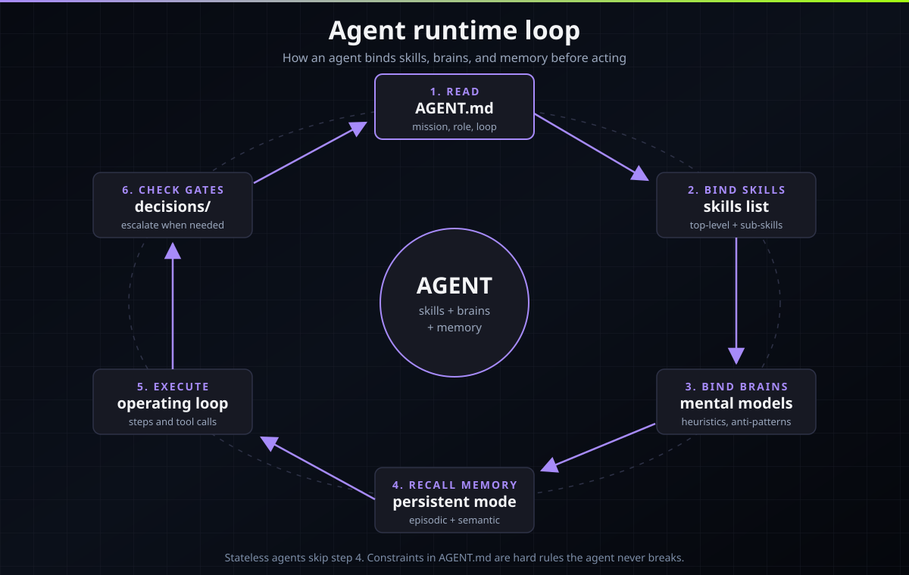

# How AgentArsenal works

This page explains the machinery: how a skill loads inside your
agent, how skills compose through dependencies, how agents bind
skills plus brains plus memory, how the installer moves skills to
your platform, and which CI gates keep the quality bar.

## How a skill loads

A skill is a folder with a `SKILL.md` file. The file starts with
YAML frontmatter, and the `description` field is the trigger: a
dense paragraph that states exactly when to load the skill ("Use
when ..."). Every platform that reads AgentArsenal skills (see
[platforms/PLATFORM_SUPPORT.md](platforms/PLATFORM_SUPPORT.md))
works the same way:

1. At session start, the agent reads only the `name` and
   `description` of each installed skill. This costs almost no
   context.
2. When your prompt matches a description, the agent loads the full
   skill body: the framing paragraph, the numbered Quick Workflow,
   the per-phase procedures with exact commands, edge cases,
   escalation paths, the defender view, and key references.
3. Supporting files ride along: `scripts/` for executable code,
   `references/` for deep material, `assets/` for templates. They
   load only when the skill body points at them.

The practical rule: a good `description` decides whether a skill
ever fires. AgentArsenal's quality scorer grades trigger density,
which is why every description is written as a "use when" trigger,
not a table of contents entry.

## Composition and dependency resolution

Skills compose through three edge types in frontmatter:

- `requires`: hard prerequisites. `webapp-pentest-methodology`
  requires `recon-active`, `web-sqli`, `web-xss`, and `auth-attacks`.
  The installer resolves the full `requires` plus `extends` closure
  and installs the whole chain.
- `extends`: specialization. A skill extends a broader one when it
  drills into one of its phases.
- `relates`: see-also links. `web-sqli` relates to `web-xss` and
  `api-security-testing`. These guide discovery, not installation.

Sub-skills add one more edge: `parent`. A sub-skill lives at
`skills/<domain>/<skill>/sub/<sub>/SKILL.md` and its `parent` field
must name the enclosing top-level skill. The parent edge is
composition, not a dependency: it never counts toward the
dependency closure, but it is checked for cycles.

The validator enforces two rules on the whole graph: every name in
`requires`, `extends`, `relates`, and `parent` must name a real
artifact, and the `requires` plus `extends` plus `parent` edges
must form no cycles. A cycle or a dangling reference fails CI.

## How agents bind skills, brains, and memory

Each agent is an `agents/<name>/AGENT.md` file with a fixed
frontmatter contract:

```yaml
skills:                    # real skill names (top-level or sub-skill)
  - nmap-methodology
brains:                    # real brain names
  - attacker-mindset
memory_mode: persistent    # or: stateless
escalation: decisions/ESCALATION_POLICY.md
constraints:
  - Never scan infrastructure you are not authorized to test.
```

At runtime the agent walks the loop in the diagram below: read its
own file (mission, role, operating loop), bind the listed skills,
bind the listed brains (mental models, heuristics, anti-patterns),
recall memory when its mode is persistent, execute its operating
loop, and check the standing decision files before any risky step.
Escalation triggers in the body say exactly when to stop and ask a
human. Constraints are hard rules the agent never breaks.



Brains are reusable judgment: files like
`brains/threat-modeling/BRAIN.md` or
`brains/attacker-mindset/BRAIN.md` with mental models, heuristics,
anti-patterns, and a worked example. Memory is the agent's
notebook: `memory/MEMORY_SCHEMA.md` defines episodic, semantic,
and procedural schemas, `memory/LIFECYCLE.md` defines capture,
consolidate, recall, and forget, and `memory/HYGIENE.md` enforces
dedup, redaction, TTLs, and audit. The `tools/memory-store/`
command line tool implements the schemas.


Playbooks sit one level above agents: `playbooks/<name>/PLAYBOOK.md`
files bind agents, skills, brains, and decisions files into a
phased operation with owners, handoffs, and stop conditions.
Workflows (`workflows/<pattern>.md`) describe reusable multi-agent
patterns such as fan-out and reviewer gates.

## The install flow

`install.sh` is a sparse installer: it copies only the skill
folders you ask for, resolving dependency closures from
`arsenal-manifest.json`, backing up the target first, and offering
rollback.

```
./install.sh --platform opencode --category web
```

This resolves the `web` domain skills, walks their
`requires`/`extends` closure, backs up
`~/.config/opencode/skills/agent-arsenal`, and copies the folders.
`--platform` maps to the platform's skills folder (see
[platforms/PLATFORM_SUPPORT.md](platforms/PLATFORM_SUPPORT.md));
`--target` overrides the path entirely; `--dry-run` prints the plan
without touching anything. Full flag reference:
[COMMANDS.md](COMMANDS.md).

## The skill lifecycle

From authoring to runtime, every skill passes through the same
pipeline. The two CI gates run on every change; the manifest then
registers the artifact with a sha256 hash, and the installer,
docs site, and marketplace all read from that manifest.


## The CI gates

Two scripts decide what merges. Both are stdlib-only Python.

**`scripts/validate.py`** runs 14 checks and exits non-zero on ANY
failure: frontmatter completeness, name matches directory slug,
description length (80 to 1500 chars) and trigger phrase, semver
version, known domain, valid lifecycle, real `last_verified` date,
dependency names resolve, no dependency cycles, agent and brain
bindings resolve, escalation path points under `decisions/`,
playbook bindings resolve, workflow structure, manifest sha256
matches, platform table matches `install.sh`, and a repo-wide
no-em-dash scan.

**`scripts/score.py`** grades every skill, agent, and brain 0 to
100 on trigger density, command quality, edge cases, and
references. Merging requires 70 or higher. Scores land in
`scores.json` and feed the docs site.

Run both before you open a PR:

```bash
python3 scripts/validate.py
python3 scripts/score.py
```

See [CONTRIBUTING.md](CONTRIBUTING.md) for the full frontmatter
standard and the body skeleton every artifact must follow.
