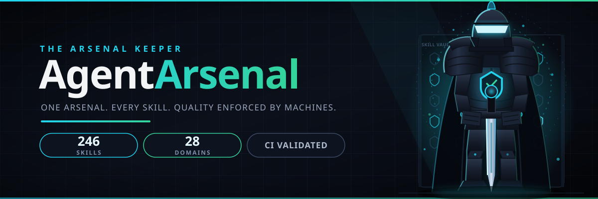

# AgentArsenal

<!-- SKILLCOUNT:START -->

<!-- SKILLCOUNT:END -->
[](LICENSE)
[](scripts/validate.py)

AgentArsenal is a unified agent-skills repo that goes deep on both software engineering craft and offensive security practice, with quality enforced by machines, not vibes. Every skill carries a version, a freshness date, and a lifecycle state; a 14-check CI harness and a 0 to 100 quality scorer keep the bar high; and a single manifest drives the installer, the docs site, and the Claude Code marketplace integration.

## Features

- **Per-skill versioning**: every skill carries semver plus a changelog entry.
- **Testing harness**: `scripts/validate.py` runs 14 checks in CI covering the frontmatter standard, directory and naming rules, and dependency acyclicity.
- **Quality scores**: `scripts/score.py` grades every skill 0 to 100 on trigger density, command quality, edge cases, and references. Merging requires 70+.
- **Dependency graph**: `requires`, `extends`, and `relates` edges between skills are validated and visualized.
- **Freshness tracking**: `last_verified` dates flag stale skills; CI fails on impossible or outdated dates.
- **Lifecycle states**: experimental, stable, deprecated. Deprecated skills stay readable but are excluded from new bundles.
- **Offline bundles**: `scripts/bundle.py` packs skills into a single portable archive with a manifest.
- **Rollback**: every release is a git tag plus a changelog entry, so a bad skill can be reverted cleanly.
- **Marketplace manifest**: `.claude-plugin/marketplace.json` exposes every skill to Claude Code directly.

## What is in the repo

- **Skills (246 across 28 domains)**: one folder per skill with `SKILL.md`. See the catalog below and `docs/index.html`.
- **Sub-skills (110)**: drill-down modules under a parent skill in `skills/<domain>/<skill>/sub/` (for example nmap host discovery or xss variants).
- **Agents (25)**: [agents/README.md](agents/README.md). Named operators that bind skills plus brains; each carries a role, an escalation policy, and constraints.
- **Brains (16)**: [brains/README.md](brains/README.md). Reusable reasoning patterns (attacker-mindset, evidence-chain, threat-modeling) that agents compose.
- **Memory system**: [memory/MEMORY_SCHEMA.md](memory/MEMORY_SCHEMA.md), [memory/LIFECYCLE.md](memory/LIFECYCLE.md), [memory/HYGIENE.md](memory/HYGIENE.md): schema, lifecycle, and hygiene rules for agent memory, plus the [memory-store](tools/memory-store/) CLI tool.
- **Decision docs (5)**: [decisions/](decisions/). Escalation policy, risk matrix, go/no-go gates, ADR template, cost-benefit analysis.
- **Playbooks (8)**: [playbooks/README.md](playbooks/README.md). End-to-end engagement scripts: ad-assessment, webapp-assessment, soc-triage-day, malware-outbreak, bug-bounty-sprint, cloud-review, external-pentest, secure-sdlc-rollout.
- **Workflows (4)**: [workflows/README.md](workflows/README.md). Multi-agent coordination patterns: pipeline, coordinator-fanout, reviewer-gate, evidence-gate.
- **CLI tools (47)**: `tools/`. Stdlib-only operator utilities with a test harness (`scripts/test_tools.py`).

## How it compares

| Capability | AgentArsenal | Typical skill repo |
| --- | --- | --- |
| Per-skill versioning | Semver plus a changelog entry on every skill | No version tracking |
| Testing harness | 14-check CI harness (`scripts/validate.py`) | No automated checks |
| Quality scores | 0 to 100 per skill, merge requires 70+ | No scoring |
| Dependency graph | Validated and visualized skill relationships | No dependency model |
| Freshness tracking | `last_verified` dates, CI flags stale skills | No freshness data |
| Lifecycle states | experimental, stable, deprecated | No lifecycle states |
| Offline bundles | Portable single-archive bundles with manifest | No bundling |
| Rollback | Git tags plus changelog entries per release | No release discipline |
| Marketplace manifest | Direct Claude Code marketplace integration | No marketplace integration |

## Works with

One `SKILL.md` standard, every major agent. The platform name is the
value for `install.sh --platform`:

| Platform | Skills folder | Install |
| --- | --- | --- |
| Claude Code | `~/.claude/skills/` | `./install.sh --platform claude-code --all` |
| OpenCode | `~/.config/opencode/skills/` | `./install.sh --platform opencode --all` |
| Codex CLI | `~/.agents/skills/` | `./install.sh --platform codex-cli --all` |
| Gemini CLI | `~/.gemini/skills/` | `./install.sh --platform gemini-cli --all` |
| Cursor | `~/.cursor/skills/` | `./install.sh --platform cursor --all` |
| GitHub Copilot | `~/.copilot/skills/` | `./install.sh --platform github-copilot --all` |
| Amp | `~/.agents/skills/` | `./install.sh --platform amp --all` |
| Goose | `~/.agents/skills/` | `./install.sh --platform goose --all` |
| Cline | `~/.agents/skills/` | `./install.sh --platform cline --all` |
| Roo Code | `~/.agents/skills/` | `./install.sh --platform roo-code --all` |
| Kilo Code | `~/.agents/skills/` | `./install.sh --platform kilo-code --all` |
| Zed | `~/.agents/skills/` | `./install.sh --platform zed --all` |
| Warp | `~/.agents/skills/` | `./install.sh --platform warp --all` |
| Windsurf | `~/.agents/skills/` | `./install.sh --platform windsurf --all` |
| Kiro | `~/.kiro/skills/` | `./install.sh --platform kiro --all` |
| Qwen Code | `~/.qwen/skills/` | `./install.sh --platform qwen-code --all` |
| Crush | `~/.agents/skills/` | `./install.sh --platform crush --all` |
| Continue | `~/.agents/skills/` | `./install.sh --platform continue --all` |
| Aider | no skills support (use `AGENTS.md`) | `./install.sh --platform aider` prints a pointer snippet |

Full paths, per-platform quirks (such as OpenCode's per-skill
permissions), and the agent memory file for each platform:
[platforms/PLATFORM_SUPPORT.md](platforms/PLATFORM_SUPPORT.md).
Run `./install.sh --list-platforms` to print this table from the
terminal.

## Architecture


## Quick install

```bash
./install.sh                              # copy stable skills into your agent's skill directory
./install.sh --list                       # show domains with skill counts, then exit
./install.sh --platform opencode --all    # install for OpenCode (19 platforms supported)
./install.sh --list-platforms             # show the supported platform table
./install.sh --dry-run                    # print what would be copied, change nothing
./install.sh --help                       # all options
```

Full flag reference: [COMMANDS.md](COMMANDS.md).

To regenerate the catalog below from `arsenal-manifest.json`:

```bash
python3 scripts/gen_readme_catalog.py
```

## Skill catalog

<!-- CATALOG:START -->
| Domain | Skills |
| --- | --- |
| ad | ad-enumeration, ad-trust-attacks, asreproasting, bloodhound-methodology, dcsync, golden-ticket, gpo-abuse, kerberoasting |
| ai-security | agent-hijacking, ai-incident-response, ai-supply-chain, guardrail-bypass-testing, llm-red-teaming, model-extraction, prompt-injection, rag-security |
| api | api-security-testing, grpc-security, openapi-security-review |
| auth | auth-attacks, password-attacks, session-management-security, webauthn-security |
| automotive | automotive-ethernet, automotive-threat-model, can-bus-security, ecu-firmware, iso21434-basics, keyless-entry-attacks, telematics-security, v2x-security |
| binary | angr-basics, binary-patching, firmware-analysis, format-strings, ghidra-basics, heap-exploitation, kernel-exploit-basics, pwn-fundamentals, rop-chains, shellcode-basics, srop-attacks |
| blockchain | blockchain-forensics, bridge-attacks, consensus-attacks, dao-governance-risks, defi-threats, nft-fraud, smart-contract-audit, wallet-security |
| bugbounty | bug-bounty-workflow |
| c2 | c2-fundamentals |
| cloud | aws-enumeration, azure-enumeration, ci-secrets-management, cloud-cost-attack-surface, cloud-forensics, cloud-security-basics, container-escape, container-image-security, gcp-enumeration, iam-privesc, k8s-pentest, kubernetes-rbac, multi-cloud-iam, s3-misconfigurations, saas-security-review, serverless-security |
| crypto | crypto-fundamentals, ecc-crypto-attacks, hash-cracking, hash-length-extension, padding-oracle, post-quantum-basics, rng-attacks, rsa-attacks, tls-analysis |
| defensive | backup-security, edr-basics, endpoint-hardening-baseline, incident-playbooks, phishing-defense, ransomware-response, security-awareness-program |
| engineering | accessibility-security, ansible-basics, api-versioning, bash-advanced, chaos-engineering, cicd-security, code-reviewer, database-migrations, debugging-methodology, devsecops-pipeline, docker-deep, feature-flags, git-workflows, github-actions, gitops-workflows, go-basics, jq-mastery, kubernetes-basics, load-testing, make-basics, nginx-hardening, performance-tuning, postgresql-tuning, prometheus-monitoring, python-advanced, python-cli-tooling, redis-basics, regex-mastery, rest-api-design, rust-basics, secrets-in-code, secure-coding, sqlite-deep, ssh-hardening, systemd-deep, technical-writing, terraform-basics, testing-strategies, tmux-workflows, typescript-basics, vim-mastery |
| forensics | browser-forensics, disk-forensics, email-forensics, forensics-fundamentals, log-forensics, memory-forensics, mobile-forensics |
| hardware | emi-emc-basics, firmware-extraction, glitching-attacks, hardware-reversing, pcb-analysis, secure-boot-bypass, side-channels, uart-jtag |
| ics-scada | dnp3-basics, historian-security, ics-incident-response, modbus-security, opc-ua-security, plc-basics, safety-systems, scada-network-seg |
| incident | crisis-communications, incident-response, tabletop-exercises |
| linux | ebpf-security, linux-container-hardening, linux-hardening |
| malware | dynamic-sandbox, packer-analysis, static-triage, yara-rules |
| memory | agent-state, memory-capture, memory-consolidation, memory-hygiene, memory-recall |
| mobile | android-dynamic, android-hardening, android-static, ios-basics, ios-dynamic-analysis |
| network | arp-spoofing, bgp-security, bluetooth-le, dhcp-attacks, dns-enumeration, firewall-evasion, ipv6-attacks, ipv6-deep-dive, llmnr-poisoning, netflow-analysis, network-pivoting, nmap-methodology, sdwan-security, smb-enumeration, snmp, stp-attacks, vlan-hopping, wireless-wpa, zero-trust-networking |
| osint | domain-osint, image-osint, osint-methodology, social-media-osint, threat-intel, username-osint |
| privacy | anonymization-techniques, consent-management, data-minimization, differential-privacy, dsr-automation, gdpr-engineering, privacy-impact-assessment, privacy-threat-model |
| privesc | privesc-linux, privesc-windows |
| recon | recon-active, recon-passive |
| soc | dark-web-monitoring, detection-as-code, dfir-timeline, edr-evasion-detection, honeypot-ops, memory-malware-hunting, purple-team-exercises, siem-detections, sigma-rules, suricata-ids, threat-actor-profiling, threat-hunting, velociraptor-basics, wazuh-basics |
| web | api-rate-limit-bypass, cache-deception, cache-poisoning, cors-misconfig, csrf, deserialization-attacks, dom-clobbering, file-upload-attacks, graphql-security, header-injection, http-request-smuggling, jwt-attacks, lfi-rfi, nosql-injection, oauth-attacks, oauth2-deep-dive, open-redirect, postmessage-security, prototype-pollution, race-conditions, ssrf, ssti, web-sqli, web-xss, webapp-pentest-methodology, websocket-security, xxe |
| **Total** | **246 skills across 28 domains** |
| Agents | 25 |
| Brains | 16 |
| Sub-skills | 110 |
| Playbooks | 8 |
| Workflows | 4 |
<!-- CATALOG:END -->

## Guides

- [AUDIENCES.md](AUDIENCES.md): who the skills are for. Cyber
  students, pentesters, SOC analysts, developers, security
  researchers, educators, bug bounty hunters, blue teams, and
  startup founders: what you get and which skills, agents, and
  brains to start with.
- [HOW_IT_WORKS.md](HOW_IT_WORKS.md): how a skill loads (the
  trigger description), composition and dependency resolution,
  how agents bind skills plus brains plus memory, the install
  flow, and the CI gates, with architecture diagrams.
- [COMMANDS.md](COMMANDS.md): the complete command reference.
  Every `install.sh` flag, every script in `scripts/`, and every
  CLI tool in `tools/` with a verified example.
- [platforms/PLATFORM_SUPPORT.md](platforms/PLATFORM_SUPPORT.md):
  the "Works with" table with each platform's skills folder,
  agent file, and install notes.

The repo currently holds 246 skills, 110 sub-skills, 25 agents,
16 brains, 8 playbooks, 4 workflows, 47 CLI tools, and 19
supported platforms (counted 2026-10-23; the catalog below is
regenerated from the manifest by Team I).

## Docs

Open `docs/index.html` in a browser for the full browsable reference: all domains, skills, dependency graph, and quality scores.

## Contributing

See [CONTRIBUTING.md](CONTRIBUTING.md) for the frontmatter standard, the body skeleton every skill must follow, and how to add a new skill with `scripts/new_skill.py`.

## Scope

**Authorized security work only.** Red team engagements with written authorization, bug bounty programs within scope, CTF competitions, security research on your own systems, and training labs. See [SECURITY.md](SECURITY.md) for the explicit rejection list.

## Credits

Built with original content. The infrastructure ideas it follows were learned from two MIT-licensed projects; see [ACKNOWLEDGEMENTS.md](ACKNOWLEDGEMENTS.md) for the full, factual attribution.
