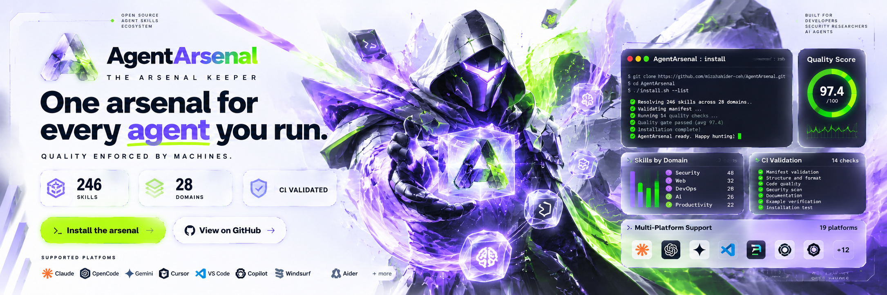
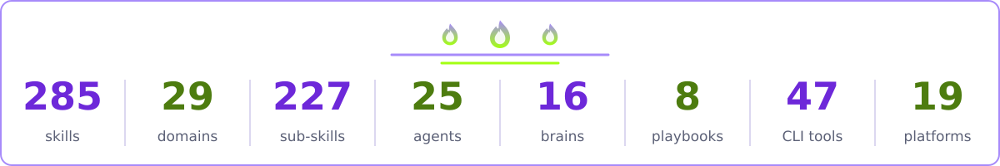
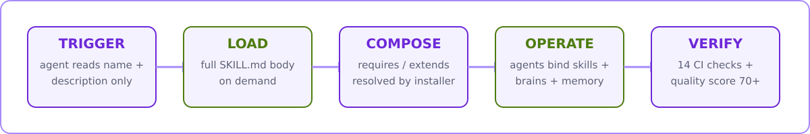
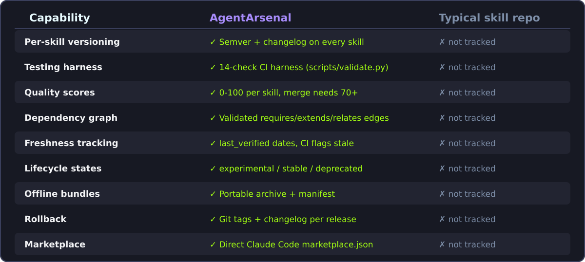
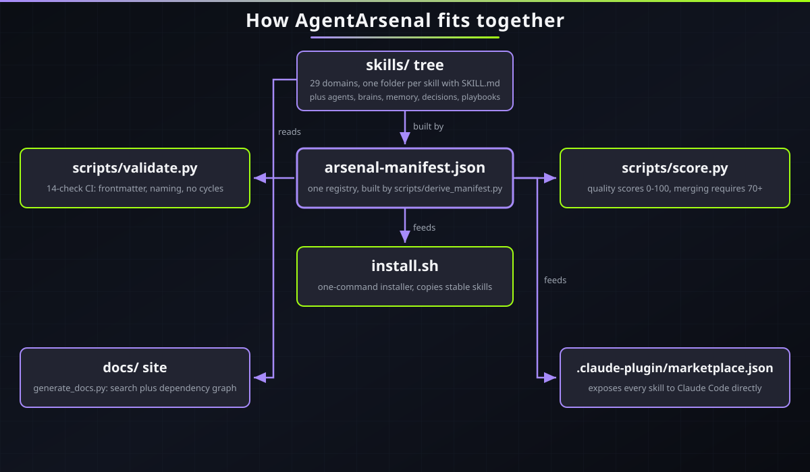
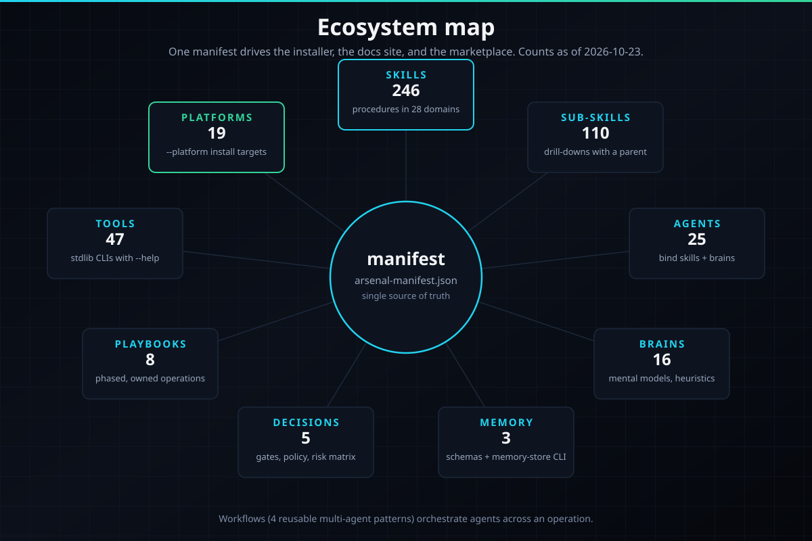
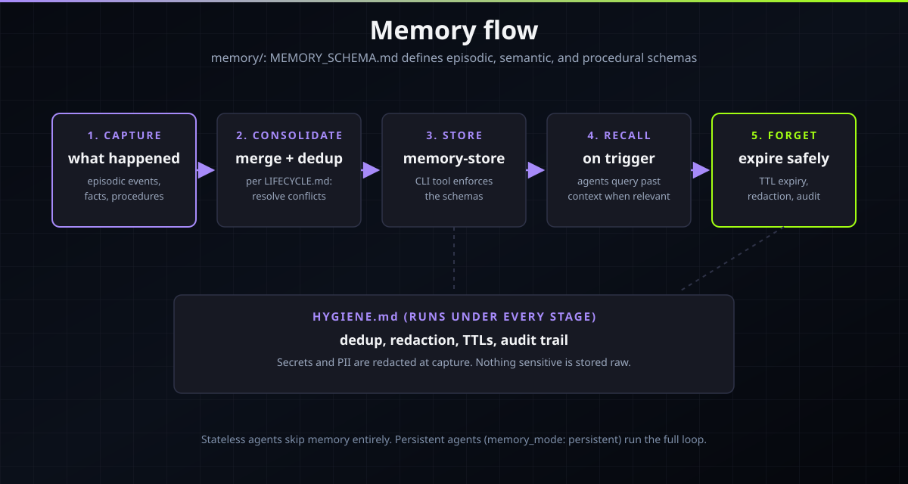
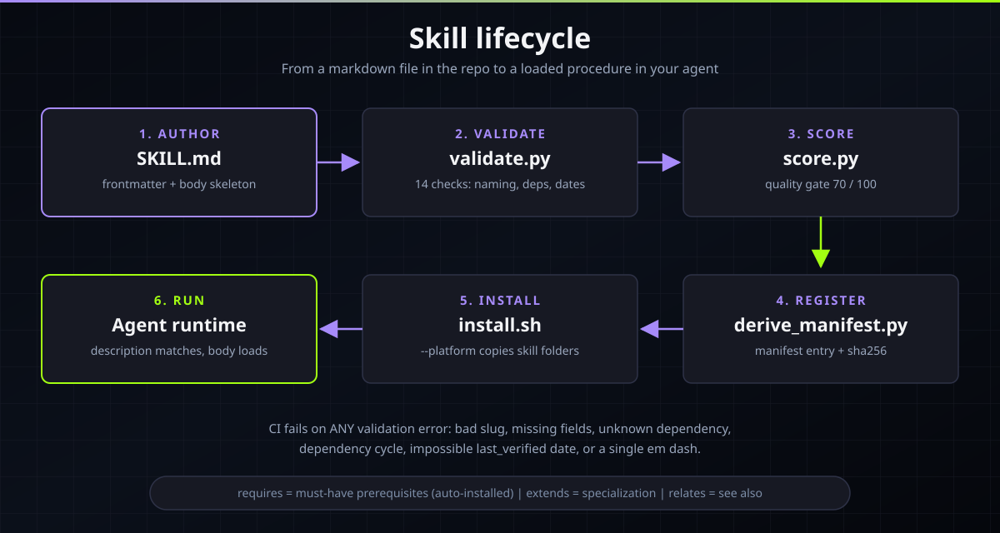
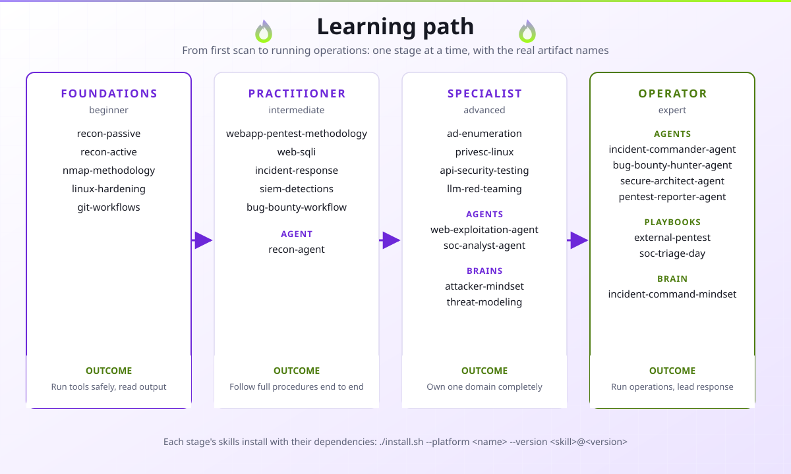

# AgentArsenal

<!-- SKILLCOUNT:START -->

<!-- SKILLCOUNT:END -->
[](../MINDMAP.md)
[](../agents/README.md)
[](../brains/README.md)
[](../platforms/PLATFORM_SUPPORT.md)
[](../tools/README.md)
[](../scores.json)
[](../scripts/validate.py)
[](../LICENSE)

**AgentArsenal es un repositorio unificado de skills para agentes que profundiza en la ingeniería de software y la práctica de la seguridad ofensiva, con la calidad impuesta por máquinas, no por intuición.**

Cada skill lleva una versión, una fecha de verificación y un estado de ciclo de vida. Un harness de CI con 14 comprobaciones y un puntuador de calidad de 0 a 100 mantienen el nivel alto. Un solo manifiesto controla el instalador, el sitio de documentación y la integración con el marketplace de Claude Code.

```diff
+ 246 skills en 28 dominios, cada una con versión, puntuación y validación de CI
+ 110 sub-skills que profundizan en las 30 skills principales de mayor valor
+ 25 agentes con nombre, 16 cerebros de razonamiento, 8 playbooks de intervención, 4 flujos multiagente
+ 47 herramientas CLI solo con la biblioteca estándar, cero dependencias de terceros
+ 19 plataformas de agentes compatibles con un solo estándar SKILL.md
- Sin blog posts dispersos, sin fragmentos sin probar, sin prompts sueltos y obsoletos
```



## Tabla de contenidos

- [Qué es AgentArsenal](#qué-es-agentarsenal)
- [Para quién es](#para-quién-es)
- [Cómo funciona](#cómo-funciona)
- [Inicio rápido](#inicio-rápido)
- [Instalación para tu plataforma](#instalación-para-tu-plataforma)
- [Referencia de comandos](#referencia-de-comandos)
- [Catálogo de skills](#catálogo-de-skills)
- [Sub-skills](#sub-skills)
- [Agentes](#agentes)
- [Cerebros](#cerebros)
- [Sistema de memoria](#sistema-de-memoria)
- [Documentos de decisión](#documentos-de-decisión)
- [Playbooks](#playbooks)
- [Flujos de trabajo](#flujos-de-trabajo)
- [Herramientas CLI](#herramientas-cli)
- [Calidad y benchmarks](#calidad-y-benchmarks)
- [Rutas de aprendizaje](#rutas-de-aprendizaje)
- [Preguntas frecuentes](#preguntas-frecuentes)
- [Estadísticas del proyecto](#estadísticas-del-proyecto)
- [Hoja de ruta](#hoja-de-ruta)
- [Cómo contribuir](#cómo-contribuir)
- [Licencia](#licencia)
- [Agradecimientos](#agradecimientos)

## Qué es AgentArsenal

AgentArsenal es una biblioteca curada de **skills** para agentes de código IA, más la maquinaria que las mantiene confiables: **agentes** (operadores con nombre), **cerebros** (patrones de razonamiento reutilizables), **sub-skills** (módulos de profundización), **playbooks** (guías de intervención de principio a fin), **flujos de trabajo** (patrones de coordinación multiagente), **documentos de decisión** (política de escalado y riesgo), un **sistema de memoria** (esquema más un CLI de SQLite) y **47 herramientas CLI** (utilidades de operador solo con la biblioteca estándar).

Una skill es una carpeta con un archivo `SKILL.md`. El archivo empieza con frontmatter YAML cuyo campo `description` es un **disparador**: un párrafo denso que dice exactamente cuándo debe cargar el agente la skill ("Use when ..."). El cuerpo luego da al agente un Quick Workflow numerado, procedimientos por fase con comandos exactos, casos límite, rutas de escalado, la visión del defensor y referencias clave. Los archivos de apoyo viajan con ella: `scripts/` para código ejecutable, `references/` para material profundo, `assets/` para plantillas. Solo se cargan cuando el cuerpo de la skill los menciona.

Lo que hace diferente a este repositorio de una carpeta de prompts:

- **Versionado por skill.** Cada skill lleva semver más una entrada de changelog. Puedes fijar `web-sqli@1.0.0` y saber exactamente qué instalaste.
- **Calidad impuesta por máquinas.** `scripts/validate.py` ejecuta 14 comprobaciones en CI (estándar de frontmatter, reglas de nombres, aciclicidad de dependencias, fechas de verificación). `scripts/score.py` puntúa cada skill de 0 a 100 en densidad de disparadores, calidad de comandos, casos límite y referencias. Fusionar requiere 70 o más. El promedio del repositorio es 95.6 y el artefacto con menor puntuación tiene 92.
- **Grafo de dependencias.** Las skills declaran aristas `requires`, `extends` y `relates`. El instalador resuelve automáticamente todo el cierre de dependencias, y la CI falla ante referencias colgadas o ciclos. El grafo se visualiza en [MINDMAP.md](../MINDMAP.md) y `docs/graph.html`.
- **Seguimiento de frescura.** Cada skill lleva una fecha `last_verified`. La CI marca fechas imposibles u obsoletas, así las skills viejas no pueden esconderse.
- **Estados de ciclo de vida.** Las skills son `experimental`, `stable` o `deprecated`. Las obsoletas siguen legibles pero se excluyen de los nuevos paquetes.
- **Paquetes sin conexión.** `scripts/bundle.py` empaqueta skills en un solo archivo portable con manifiesto para entornos aislados.
- **Reversión.** Cada release es una etiqueta de git más una entrada de changelog, e `install.sh` respalda el destino antes de tocarlo. Una skill defectuosa se revierte limpiamente.
- **Manifiesto de marketplace.** `.claude-plugin/marketplace.json` expone cada skill directamente a Claude Code.





| Capacidad | AgentArsenal | Repositorio de skills típico |
| --- | --- | --- |
| Versionado por skill | :white_check_mark: Semver más entrada de changelog en cada skill | :x: Sin control de versiones |
| Harness de pruebas | :white_check_mark: Harness de CI con 14 comprobaciones (`scripts/validate.py`) | :x: Sin comprobaciones automatizadas |
| Puntuaciones de calidad | :white_check_mark: 0 a 100 por skill, fusionar requiere 70+ | :x: Sin puntuación |
| Grafo de dependencias | :white_check_mark: Relaciones validadas y visualizadas | :x: Sin modelo de dependencias |
| Seguimiento de frescura | :white_check_mark: Fechas `last_verified`, la CI marca obsoletas | :x: Sin datos de frescura |
| Estados de ciclo de vida | :white_check_mark: experimental, stable, deprecated | :x: Sin estados de ciclo de vida |
| Paquetes sin conexión | :white_check_mark: Paquetes portables de un archivo con manifiesto | :x: Sin empaquetado |
| Reversión | :white_check_mark: Etiquetas de git más entradas de changelog por release | :x: Sin disciplina de releases |
| Manifiesto de marketplace | :white_check_mark: Integración directa con el marketplace de Claude Code | :x: Sin integración de marketplace |

## Para quién es

Guía completa de audiencias: [AUDIENCES.md](../AUDIENCES.md). Cada nombre de abajo es un artefacto real de este repositorio. Instala los iniciales con el instalador selectivo, por ejemplo `./install.sh --version nmap-methodology@1.0.0` o `./install.sh --category web`.

### :mortar_board: Estudiantes de ciberseguridad
**Lo que obtienes:** una ruta estructurada desde los fundamentos hasta una metodología completa, con cada procedimiento escrito como pasos de operador numerados y comandos exactos. Las skills reemplazan blog posts dispersos con una sola fuente curada que un puntuador de calidad ya evaluó.
**Empieza con:** skills `recon-passive`, `recon-active`, `nmap-methodology`, `linux-hardening`, `web-sqli`, `webapp-pentest-methodology`, `python-cli-tooling`, `git-workflows`; agente `recon-agent`; cerebro `scientific-debugging`.

### :crossed_swords: Pentesters
**Lo que obtienes:** metodología completa de intervención, del reconocimiento al informe, con instalación consciente de dependencias (la cadena `requires` de una skill se instala sola) y rutas de escalado cuando el camino estándar falla.
**Empieza con:** skills `webapp-pentest-methodology`, `ad-enumeration`, `bloodhound-methodology`, `privesc-linux`, `privesc-windows`, `network-pivoting`, `c2-fundamentals`, `password-attacks`, `api-security-testing`; agentes `recon-agent`, `web-exploitation-agent`, `pentest-reporter-agent`.

### :rotating_light: Analistas SOC
**Lo que obtienes:** runbooks de triaje, contenido de detección y procedimientos DFIR escritos como listas que tu agente puede ejecutar durante un turno en vivo.
**Empieza con:** skills `siem-detections`, `sigma-rules`, `suricata-ids`, `threat-hunting`, `dfir-timeline`, playbook `soc-triage-day`; agente `soc-analyst-agent`; cerebro `opa-decision-loop`.

### :computer: Desarrolladores
**Lo que obtienes:** skills de oficio de ingeniería que hacen de tu agente un mejor programador en pareja: código seguro, revisión de código, metodología de depuración, CI/CD, contenedores y estrategias de pruebas.
**Empieza con:** skills `secure-coding`, `code-reviewer`, `debugging-methodology`, `git-workflows`, `docker-deep`, `testing-strategies`; agente `code-review-agent`; cerebro `scientific-debugging`.

### :microscope: Investigadores de seguridad
**Lo que obtienes:** material profundo sobre explotación de binarios, criptografía, hardware y seguridad de IA, con referencias y casos límite en vez de resúmenes superficiales.
**Empieza con:** skills `pwn-fundamentals`, `rop-chains`, `heap-exploitation`, `ghidra-basics`, `rsa-attacks`, `llm-red-teaming`; agente `binary-exploitation-agent`; cerebro `hypothesis-driven-testing`.

### :teacher: Educadores
**Lo que obtienes:** una columna vertebral curricular lista. Las [rutas de aprendizaje](../docs/learning-paths/BEGINNER.md) ordenan las skills de principiante a experto, y cada skill tiene el mismo esqueleto de cuerpo (Quick Workflow, Edge cases, Key references) para que los planes de clase se escriban solos.
**Empieza con:** los dominios `recon` y `network`, el cerebro `scientific-debugging` y el playbook `soc-triage-day` para laboratorios de blue team.

### :moneybag: Cazadores de bug bounty
**Lo que obtienes:** un flujo de caza sistemático y plantillas de informe que se aceptan y se pagan, más las skills de ataque web y API que cubren los objetivos más comunes.
**Empieza con:** skills `bug-bounty-workflow`, `webapp-pentest-methodology`, `api-security-testing`, `recon-active`; agente `bug-bounty-hunter-agent`; playbook `bug-bounty-sprint`.

### :shield: Blue teams
**Lo que obtienes:** ingeniería de detección, líneas base de hardening, playbooks de incidentes y ejercicios de purple team que prueban que las detecciones funcionan en vez de asumirlo.
**Empieza con:** skills `detection-as-code`, `sigma-rules`, `endpoint-hardening-baseline`, `incident-playbooks`, `purple-team-exercises`; agente `purple-team-agent`; cerebro `defender-mindset`.

### :rocket: Fundadores de startups
**Lo que obtienes:** una línea base de seguridad pragmática sin contratar un equipo: despliegue de SDLC, revisión de nube, gestión de secretos e ingeniería de privacidad, a la medida de equipos pequeños.
**Empieza con:** playbook `secure-sdlc-rollout`, skills `cloud-security-basics`, `secrets-in-code`, `gdpr-engineering`; agente `secure-architect-agent`; cerebro `cost-of-attack`.

## Cómo funciona

Análisis profundo: [HOW_IT_WORKS.md](../HOW_IT_WORKS.md). La versión corta:

### :zap: Carga de skills (revelado progresivo)
Al iniciar la sesión, el agente lee solo el `name` y la `description` de cada skill instalada. Esto casi no cuesta contexto. Cuando tu prompt coincide con una descripción, el agente carga el cuerpo completo de la skill: el párrafo de encuadre, el Quick Workflow numerado, procedimientos por fase con comandos exactos, casos límite, rutas de escalado, la visión del defensor y referencias clave. Una buena `description` decide si una skill llega a usarse, por eso el puntuador de calidad evalúa la densidad de disparadores.

### :link: Composición y el grafo de dependencias
Las skills se componen mediante tres tipos de aristas en el frontmatter:

- `requires`: prerrequisitos duros. `webapp-pentest-methodology` requiere `recon-active`, `web-sqli`, `web-xss` y `auth-attacks`. El instalador resuelve todo el cierre de `requires` más `extends` e instala la cadena completa.
- `extends`: especialización. Una skill extiende otra más amplia cuando profundiza en una de sus fases.
- `relates`: enlaces de "ver también". `web-sqli` se relaciona con `web-xss` y `api-security-testing`. Guían el descubrimiento, no la instalación.

Las sub-skills añaden una arista más: `parent`. Una sub-skill vive en `skills/<domain>/<skill>/sub/<sub>/SKILL.md` y su campo `parent` debe nombrar la skill principal que la contiene. El validador impone dos reglas sobre todo el grafo: cada nombre debe resolver a un artefacto real, y las aristas `requires` más `extends` más `parent` no deben formar ciclos. Un ciclo o una referencia colgada falla la CI.

### :busts_in_silhouette: Los agentes combinan skills más cerebros más memoria
Cada agente es un archivo `agents/<name>/AGENT.md` con un contrato fijo de frontmatter: un rol, las skills que carga, los cerebros con los que razona, un modo de memoria (`stateless` o `persistent`), un archivo de escalado y restricciones duras que nunca rompe. Los agentes son roles operativos que puedes ejecutar: `recon-agent` convierte objetivos desconocidos en un inventario acotado, `pentest-reporter-agent` convierte hallazgos en bruto en informes en los que confían los ejecutivos.

### :brain: Los cerebros son patrones de razonamiento reutilizables
Cerebros como `attacker-mindset` (piensa en grafos de ataque, toma el camino más barato), `evidence-chain` (cada afirmación rastrea a una fuente) y `threat-modeling` (activos primero, límites de confianza, enumeración estilo STRIDE) se conectan a cualquier agente. Dieciséis cerebros cubren razonamiento ofensivo, razonamiento defensivo, depuración, mando de incidentes y toma de decisiones bajo presión.

### :floppy_disk: La memoria tiene un esquema, no solo intuición
La memoria del agente sigue [memory/MEMORY_SCHEMA.md](../memory/MEMORY_SCHEMA.md): entradas episódicas (eventos con marca temporal, TTL de 30 días), entradas semánticas (hechos duraderos) y entradas procedurales (cómo se hacen las cosas). [memory/LIFECYCLE.md](../memory/LIFECYCLE.md) define captura, consolidación y expiración; [memory/HYGIENE.md](../memory/HYGIENE.md) la mantiene limpia. El CLI [memory-store](../tools/memory-store/) es un pequeño almacén SQLite que los agentes usan para leer y escribir memoria.

### :scroll: Las decisiones ponen los límites
Cinco documentos de decisión permanentes en [decisions/](../decisions/): política de escalado, matriz de riesgo, puertas de go/no-go, plantilla de ADR y análisis de costo-beneficio. Los agentes apuntan a estos archivos en su frontmatter, así que "cuándo me detengo y pregunto a un humano" es política, no improvisación.

### :clipboard: Los playbooks dirigen la intervención
Un playbook combina agentes, skills, cerebros y decisiones en un runbook ordenado con fases, criterios de entrada y salida, roles y traspasos, condiciones de parada y artefactos producidos. Ocho playbooks cubren evaluaciones de AD, evaluaciones de aplicaciones web, pentests externos, sprints de bug bounty, revisiones de nube, días de triaje SOC, brotes de malware y despliegues de SDLC seguro.

### :white_check_mark: Las puertas de CI mantienen el nivel
`scripts/validate.py` ejecuta 14 comprobaciones sobre cada artefacto: campos requeridos de frontmatter, nombre que coincide con el directorio, descripciones densas en disparadores, versiones semver, valores válidos de ciclo de vida, fechas `last_verified` sensatas, resolución de dependencias, aciclicidad del grafo, encabezados requeridos del cuerpo (Quick Workflow, Edge cases, Key references), aristas `parent` de sub-skills, contratos de agentes/cerebros/playbooks, consistencia del manifiesto y nada de rayas em en el contenido. `scripts/score.py` luego puntúa la calidad de 0 a 100. Fusionar necesita 70+. Todo lo rojo falla la compilación.





## Inicio rápido

```bash
git clone https://github.com/mizazhaider-ceh/AgentArsenal.git
cd AgentArsenal
./install.sh --list            # muestra dominios con conteo de skills, luego sale
./install.sh --dry-run         # muestra lo que se copiaría, sin cambiar nada
./install.sh                   # copia las skills estables a tu directorio de skills
```

Instalaciones dirigidas:

```bash
./install.sh --category web --dry-run        # vista previa de un dominio
./install.sh --category web                  # instala todo el dominio web
./install.sh --version web-sqli@1.0.0        # fija una skill a una versión
./install.sh --platform opencode --all       # instala para OpenCode (19 plataformas)
./install.sh --list-platforms                # muestra la tabla de plataformas
./install.sh --rollback                      # restaura el respaldo previo
./install.sh --help                          # todas las opciones
```

Referencia completa de flags: [COMMANDS.md](../COMMANDS.md).

## Instalación para tu plataforma

Un estándar `SKILL.md`, todos los agentes principales. El nombre de la plataforma es el valor para `install.sh --platform`. Rutas completas, peculiaridades por plataforma (como los permisos por skill de OpenCode) y el archivo de memoria de cada plataforma: [platforms/PLATFORM_SUPPORT.md](../platforms/PLATFORM_SUPPORT.md).

| Plataforma | Comando de instalación | Carpeta de skills |
| --- | --- | --- |
| Claude Code | `./install.sh --platform claude-code --all` | `~/.claude/skills/` |
| OpenCode | `./install.sh --platform opencode --all` | `~/.config/opencode/skills/` |
| Codex CLI | `./install.sh --platform codex-cli --all` | `~/.agents/skills/` |
| Gemini CLI | `./install.sh --platform gemini-cli --all` | `~/.gemini/skills/` |
| Cursor | `./install.sh --platform cursor --all` | `~/.cursor/skills/` |
| GitHub Copilot | `./install.sh --platform github-copilot --all` | `~/.copilot/skills/` |
| Amp | `./install.sh --platform amp --all` | `~/.agents/skills/` |
| Goose | `./install.sh --platform goose --all` | `~/.agents/skills/` |
| Cline | `./install.sh --platform cline --all` | `~/.agents/skills/` |
| Roo Code | `./install.sh --platform roo-code --all` | `~/.agents/skills/` |
| Kilo Code | `./install.sh --platform kilo-code --all` | `~/.agents/skills/` |
| Zed | `./install.sh --platform zed --all` | `~/.agents/skills/` |
| Warp | `./install.sh --platform warp --all` | `~/.agents/skills/` |
| Windsurf | `./install.sh --platform windsurf --all` | `~/.agents/skills/` |
| Kiro | `./install.sh --platform kiro --all` | `~/.kiro/skills/` |
| Qwen Code | `./install.sh --platform qwen-code --all` | `~/.qwen/skills/` |
| Crush | `./install.sh --platform crush --all` | `~/.agents/skills/` |
| Continue | `./install.sh --platform continue --all` | `~/.agents/skills/` |
| Aider | `./install.sh --platform aider` muestra un fragmento de puntero | sin soporte de skills (usa `AGENTS.md`) |

:bulb: **Consejo:** ejecuta cualquier comando primero con `--dry-run` para ver exactamente qué se copiará. El instalador respalda tus skills existentes antes de tocarlas.

## Referencia de comandos

Referencia completa con ejemplos verificados: [COMMANDS.md](../COMMANDS.md). Resumen:

<details>
<summary><strong>Expandir el resumen de comandos</strong></summary>

### install.sh (el instalador selectivo)

Copia las carpetas de skills elegidas al directorio de skills de una plataforma, resolviendo las cadenas `requires`/`extends` desde `arsenal-manifest.json`. Respalda el destino antes de tocarlo.

| Flag | Qué hace |
| --- | --- |
| `--all` | Instala cada skill del manifiesto |
| `--category <name>` | Instala un dominio (ver nombres con `--list`) |
| `--version <skill@ver>` | Instala una skill en una versión fijada, falla si no coincide |
| `--platform <name>` | Define el destino como la carpeta de skills de una plataforma |
| `--target <dir>` | Directorio de instalación personalizado |
| `--list` | Muestra dominios con conteo de skills, luego sale |
| `--list-platforms` | Muestra la tabla de plataformas compatibles, luego sale |
| `--dry-run` | Muestra lo que se copiaría, sin cambiar nada |
| `--rollback` | Restaura el respaldo más reciente del destino |
| `--help` | Todas las opciones |

### scripts/

| Script | Qué hace |
| --- | --- |
| `scripts/validate.py` | Validador de CI con 14 comprobaciones sobre cada artefacto, sale distinto de cero ante cualquier fallo |
| `scripts/score.py` | Puntuador de calidad de 0 a 100 por artefacto (fusionar necesita 70+) |
| `scripts/bundle.py` | Empaqueta skills en un archivo portable sin conexión con manifiesto |
| `scripts/derive_manifest.py` | Regenera `arsenal-manifest.json` desde el árbol del repositorio |
| `scripts/gen_readme_catalog.py` | Regenera la insignia de conteo y el catálogo del README desde el manifiesto |
| `scripts/gen_marketplace.py` | Regenera `.claude-plugin/marketplace.json` |
| `scripts/generate_docs.py` | Construye el sitio de documentación navegable en `docs/` |
| `scripts/new_skill.py` | Crea una nueva skill con frontmatter válido y esqueleto de cuerpo |
| `scripts/test_tools.py` | Harness de pruebas para las 47 herramientas CLI |

### tools/ (47 CLIs solo con la biblioteca estándar)

```bash
python3 tools/port-scanner/port-scanner.py scanme.example.com -p 1-1024
python3 tools/file-hasher/file-hasher.py document.pdf
python3 tools/subnet-calculator/subnet-calculator.py 192.168.1.0/24
```

Cada herramienta acepta `--help`, sale 0 en éxito y 2 en errores de uso. Tabla completa en [Herramientas CLI](#herramientas-cli).

</details>
## Catálogo de skills

246 skills en 28 dominios. Regenerado desde `arsenal-manifest.json` con `scripts/gen_readme_catalog.py`.

> **Nota de traducción:** las descripciones de cada skill se mantienen en inglés porque son los textos disparadores originales de los archivos `SKILL.md`, que están en inglés. Los resúmenes por dominio sí están traducidos.

<details>
<summary><strong>Expandir el catálogo completo: 246 skills</strong></summary>

### :key: ad (8 skills)

*Rutas de ataque de Active Directory, de la enumeración a la forja de tickets, para evaluaciones internas autorizadas.*

- `ad-enumeration`: mapping an authorized Active Directory environment during an internal assessment or assumed breach exercise. AD enumeration with kerbrute for Kerberos user discovery, ldapsearch for direct LDAP queries, NetExec modules for SMB, LDAP, and WinRM enumeration, and BloodHound with SharpHound for attack path analysis.
- `ad-trust-attacks`: assessing Active Directory trust relationships on an authorized engagement. Covers trust enumeration, SID history abuse, cross forest Kerberos attacks, and trust direction review.
- `asreproasting`: testing Active Directory for AS-REP roasting on an authorized engagement. Covers finding accounts with Kerberos preauthentication disabled, requesting crackable AS-REP responses with GetNPUsers.py from impacket 0.12.0 and Rubeus 2.x, and offline cracking of krbasrep5 hashes with hashcat 6.2.6 mode 18200 or John the Ripper 1.9.0-jumbo-1.
- `bloodhound-methodology`: mapping Active Directory attack paths on an authorized engagement.
- `dcsync`: pulling Active Directory credential material through directory replication on an authorized engagement.
- `golden-ticket`: forging Kerberos tickets on an authorized Active Directory engagement after recovering the krbtgt account hash.
- `gpo-abuse`: assessing Group Policy security on an authorized AD engagement. Covers GPO enumeration, dangerous settings review, GPO based privilege escalation paths, and delegation review.
- `kerberoasting`: testing Active Directory for Kerberoasting on an authorized engagement. Covers SPN enumeration, TGS ticket requests with GetUserSPNs.py and Rubeus, offline cracking of krb5tgs hashes with hashcat 6.2.6, and targeted Kerberoasting against accounts you can write SPNs to.

### :robot: ai-security (8 skills)

*Ataque y defensa de sistemas LLM y agentes de IA: inyección de prompts, red teaming, guardrails, cadena de suministro.*

- `agent-hijacking`: testing an AI agent that can call tools or take actions on an authorized engagement. Covers tool output poisoning, confused deputy attacks, excessive agency, and prompt driven abuse of email, calendar, code execution, and browser tools.
- `ai-incident-response`: responding to a suspected security incident involving an AI system: a hijacked agent, a poisoned model, leaked prompts, or abusive use of inference infrastructure.
- `ai-supply-chain`: reviewing the supply chain of an AI system on an authorized assessment: model weights, datasets, base images, and third party integrations. Covers model provenance checks, poisoned dataset detection, dependency review for ML pipelines, and signing of artifacts.
- `guardrail-bypass-testing`: testing whether an LLM application's safety guardrails can be bypassed on an authorized engagement. Covers refusal classifier evasion, encoding tricks, roleplay framing, low resource language pivots, and multi step decomposition of refused requests.
- `llm-red-teaming`: running a structured red team exercise against an LLM application with authorization. Covers scoping, attack categorization (jailbreak, data extraction, insecure output, excessive agency), systematic test matrices, and scoring findings by impact.
- `model-extraction`: assessing whether a machine learning model behind an API can be stolen or copied on an authorized engagement. Covers prediction API scraping, membership inference, model inversion, and functionality stealing through systematic querying.
- `prompt-injection`: testing an LLM powered application for prompt injection on an authorized assessment. Covers direct and indirect injection, system prompt extraction, instruction override, delimiter smuggling, and multi-turn manipulation against chatbots, copilots, and agents.
- `rag-security`: assessing a retrieval augmented generation system on an authorized engagement. Covers document poisoning, embedding inversion, retrieval manipulation, context window stuffing, and access control gaps between the retriever and the user.

### :electric_plug: api (3 skills)

*Prueba y revisión de APIs: pruebas de seguridad, gRPC, revisión de OpenAPI, abuso de límites de tasa.*

- `api-security-testing`: testing REST, GraphQL, or internal APIs on an authorized engagement.
- `grpc-security`: assessing gRPC services on an authorized engagement. Covers service enumeration via reflection, auth review, message validation, and intercepting gRPC traffic.
- `openapi-security-review`: reviewing an OpenAPI specification for security issues on an authorized engagement. Covers contract vs implementation drift, auth scheme review, schema validation gaps, and finding hidden endpoints.

### :lock: auth (4 skills)

*Romper y arreglar la autenticación: ataques de credenciales, manejo de sesiones, WebAuthn.*

- `auth-attacks`: testing authentication on an authorized engagement.
- `password-attacks`: cracking password hashes or auditing password strength on an authorized engagement. Covers hash identification, hashcat 6.2.6 and John the Ripper 1.9.0-jumbo-1 workflows, wordlist strategy, rule-based mutation, mask and hybrid attacks, and interpreting results for the report.
- `session-management-security`: assessing session management on an authorized web engagement. Covers cookie attributes, session fixation, timeout and rotation, concurrent session handling, and logout completeness.
- `webauthn-security`: assessing or implementing WebAuthn and passkeys on an authorized engagement. Covers registration and authentication ceremonies, attestation review, common implementation flaws, and fallback security.

### :car: automotive (8 skills)

*Seguridad de vehículos: bus CAN, ECUs, entrada sin llave, ISO 21434, V2X.*

- `automotive-ethernet`: assessing automotive Ethernet on a vehicle or bench setup you own or have authorization to test. Covers BroadR-Reach and 100BASE-T1 basics, SOME/IP service discovery, DoIP diagnostics, and VLAN segmentation in zonal architectures.
- `automotive-threat-model`: building a threat model for a vehicle or automotive component on an authorized engagement. Covers asset and attacker profiling, attack surface mapping across interfaces, attack trees for key scenarios, and prioritizing testing from the model.
- `can-bus-security`: assessing CAN bus security on a vehicle or bench setup you own or have authorization to test. Covers CAN sniffing with SocketCAN, message reverse engineering, injection testing, and gateway segmentation review.
- `ecu-firmware`: analyzing ECU firmware on an authorized assessment or your own bench hardware. Covers firmware extraction from ECUs, update package analysis, UDS flashing flows, and static review of automotive code.
- `iso21434-basics`: you need working knowledge of ISO/SAE 21434 for automotive cybersecurity work. Covers the standard's structure, TARA (threat analysis and risk assessment), cybersecurity planning, and how assessments map to its clauses.
- `keyless-entry-attacks`: assessing keyless entry and immobilizer systems on vehicles you own or have authorization to test, in a lab setting. Covers relay attack concepts, rolling code analysis, and defensive review of key fob protocols.
- `telematics-security`: assessing a telematics unit or connected car backend on an authorized engagement. Covers TCU architecture, cellular attack surface, backend API review, and remote command flows.
- `v2x-security`: assessing vehicle to everything communication on an authorized engagement or lab setup. Covers DSRC and C-V2X basics, message types (BSM, CAM, DENM), PKI and certificate review, and misbehavior detection concepts.

### :nut_and_bolt: binary (11 skills)

*Ingeniería inversa y explotación: fundamentos de pwn, ROP, heap, shellcode, Ghidra, angr.*

- `angr-basics`: you need symbolic execution to explore program paths automatically, typically for CTF binaries, crackmes, or vulnerability research on code you are authorized to analyze.
- `binary-patching`: patching binaries in a lab on authorized targets: your own software, CTF binaries, or client approved test builds. Covers byte patching, assembly level fixes, and verifying patches.
- `firmware-analysis`: analyzing a firmware image from a device you own or are authorized to test. Covers Binwalk scanning and extraction, entropy analysis, SquashFS and archive recovery, bootloader and kernel identification, hunting hardcoded credentials and keys, and reverse engineering extracted binaries with Ghidra.
- `format-strings`: you need to exploit a format string vulnerability on an authorized target, such as a CTF pwn challenge or lab binary that passes user input directly to printf or a similar function.
- `ghidra-basics`: you need to reverse engineer a compiled binary on an authorized task, such as a CTF reversing challenge, malware triage in a lab, or auditing a binary you have permission to analyze.
- `heap-exploitation`: you need to exploit a heap memory bug on an authorized target, such as a CTF pwn challenge with use-after-free, heap overflow, or double free, or a lab binary using malloc and free unsafely.
- `kernel-exploit-basics`: learning kernel exploitation fundamentals in a lab with your own vulnerable VMs. Covers kernel attack surface, common bug classes, SMEP/SMAP/KASLR bypass concepts, and safe lab practices.
- `pwn-fundamentals`: you need to exploit a classic stack buffer overflow on an authorized target, such as a CTF pwn challenge or a lab binary you have permission to test.
- `rop-chains`: you need to build a Return Oriented Programming chain on an authorized target, such as a CTF pwn challenge with NX enabled and no easy win function.
- `shellcode-basics`: you need to write or use position-independent machine code payloads on an authorized target, such as a CTF pwn challenge where NX is disabled, a buffer you can execute, or a ROP chain that made memory writable and executable.
- `srop-attacks`: learning Sigreturn Oriented Programming in a lab on CTF style binaries you own. Covers sigreturn mechanics, frame forging, and chaining syscalls without gadgets.

### :link: blockchain (8 skills)

*Auditorías de smart contracts, amenazas DeFi, ataques a puentes, billeteras, forense en cadena.*

- `blockchain-forensics`: tracing cryptocurrency in an investigation on an authorized case. Covers address clustering, transaction graph analysis, exchange attribution, and following funds through mixers and bridges at the methodology level.
- `bridge-attacks`: assessing cross chain bridge security on an authorized engagement. Covers bridge architectures, validator and relayer trust models, message verification flaws, and the classic bridge hack patterns.
- `consensus-attacks`: you need working knowledge of consensus layer attacks for blockchain security assessments. Covers 51 percent attacks, selfish mining, long range attacks on PoS, eclipse attacks, and finality concepts.
- `dao-governance-risks`: assessing DAO governance security on an authorized engagement. Covers vote buying, flash loan governance attacks, proposal thresholds, timelock review, and multisig versus token vote tradeoffs.
- `defi-threats`: assessing DeFi protocols for economic and technical attacks on an authorized engagement. Covers flash loan attacks, oracle manipulation, sandwich attacks, and governance takeovers at the design level.
- `nft-fraud`: assessing NFT projects, marketplaces, or fraud patterns on an authorized engagement. Covers wash trading detection, metadata and minting flaws, phishing against collectors, and marketplace logic review.
- `smart-contract-audit`: auditing Solidity smart contracts on an authorized engagement or for your own project. Covers static analysis with Slither, manual review of access control and arithmetic, reentrancy testing, and upgradeability review.
- `wallet-security`: reviewing cryptocurrency wallet security for users or on an authorized product assessment. Covers seed phrase handling, hardware versus software wallets, transaction signing risks, and common theft techniques to defend against.

### :moneybag: bugbounty (1 skills)

*Ejecutar un flujo de bug bounty de principio a fin, del reconocimiento al informe pagado.*

- `bug-bounty-workflow`: hunting on a bug bounty program and you need a repeatable, professional methodology from scope to payout.

### :satellite: c2 (1 skills)

*Fundamentos de mando y control para operaciones autorizadas de red team.*

- `c2-fundamentals`: designing the command and control layer of an authorized red team or adversary emulation exercise.

### :cloud: cloud (16 skills)

*Superficie de ataque en la nube: enumeración de AWS, Azure y GCP, escalado de privilegios IAM, contenedores, Kubernetes, serverless.*

- `aws-enumeration`: enumerating an AWS environment during an authorized cloud assessment, bug bounty engagement, or lab exercise.
- `azure-enumeration`: enumerating a Microsoft Azure tenant or subscription during an authorized cloud assessment, bug bounty engagement, or lab exercise.
- `ci-secrets-management`: reviewing how CI/CD pipelines handle secrets on an authorized assessment. Covers secret storage in pipeline config, log leakage, pull request exposure, and OIDC versus long lived tokens.
- `cloud-cost-attack-surface`: assessing cloud cost as an attack surface on an authorized engagement. Covers denial of wallet, resource exhaustion billing, free tier abuse, and cost anomaly detection.
- `cloud-forensics`: doing forensics in cloud environments on an authorized investigation. Covers log sources per provider, snapshot and disk acquisition, volatile evidence in ephemeral workloads, and timeline building from cloud audit trails.
- `cloud-security-basics`: reviewing cloud security posture at concept level across AWS, GCP, and Azure, when checking IAM for least privilege and wildcard grants, when hunting public storage buckets and open security groups.
- `container-escape`: testing container escape during an authorized security assessment, CTF, or lab exercise.
- `container-image-security`: assessing container image security on an authorized engagement or in your own pipeline. Covers image scanning, base image choice, secret leakage in layers, and signing with Cosign.
- `gcp-enumeration`: enumerating a Google Cloud project, folder, or organization during an authorized cloud assessment, bug bounty engagement, or lab exercise.
- `iam-privesc`: assessing AWS IAM privilege escalation paths during an authorized cloud assessment, bug bounty engagement, or lab exercise.
- `k8s-pentest`: penetration testing Kubernetes clusters on an authorized engagement. Covers cluster enumeration, RBAC abuse, pod escape to node, etcd access, and service account token theft.
- `kubernetes-rbac`: enumerating and testing Kubernetes RBAC during an authorized cloud or cluster assessment, bug bounty engagement, or lab exercise.
- `multi-cloud-iam`: reviewing identity across multiple cloud providers on an authorized engagement. Covers federated identity design, cross cloud role assumptions, consistent least privilege, and finding the weakest provider.
- `s3-misconfigurations`: testing Amazon S3 buckets for misconfigurations during an authorized cloud assessment, bug bounty engagement, or lab exercise.
- `saas-security-review`: reviewing the security of a SaaS application your organization uses or builds. Covers SSO and SCIM, data residency, tenant isolation, admin controls, and offboarding.
- `serverless-security`: assessing serverless applications (Lambda, Cloud Functions, Azure Functions) on an authorized engagement. Covers function enumeration, event injection, IAM role abuse, and insecure dependencies.

### :closed_lock_with_key: crypto (9 skills)

*Ataques de criptografía aplicada: RSA, oráculos de padding, crackeo de hashes, análisis TLS.*

- `crypto-fundamentals`: you face hashes, tokens, or ciphertext on an authorized test, CTF, or code review and need an operator-grade crypto workflow.
- `ecc-crypto-attacks`: assessing elliptic curve cryptography on an authorized engagement. Covers weak curve parameters, invalid curve attacks, nonce reuse in ECDSA, and implementation review.
- `hash-cracking`: you need to recover plaintexts from password hashes on an authorized engagement, such as cracking NTLM hashes from a domain dump, testing password strength after extracting hashes in scope, or solving CTF crypto challenges.
- `hash-length-extension`: testing for hash length extension attacks on an authorized assessment. Covers Merkle Damgard hashes, forging authenticated payloads with hashpump style extension, and reviewing MAC constructions.
- `padding-oracle`: you encounter CBC-mode ciphertext with distinguishable padding errors on an authorized test, CTF, or code review, and need to decrypt or forge messages without the key.
- `post-quantum-basics`: you need working knowledge of post quantum cryptography for planning and assessment. Covers the threat model, NIST standardized algorithms, hybrid deployments, and migration planning.
- `rng-attacks`: assessing random number generation on an authorized engagement. Covers weak PRNGs, seed prediction, VM snapshot issues, and reviewing randomness sources in code. Also use when tokens, keys, or nonces look predictable.
- `rsa-attacks`: you face an RSA challenge or misconfigured RSA on an authorized test, CTF, or code review and need an operator workflow for the classic attacks.
- `tls-analysis`: assessing the TLS configuration of a service you own or are authorized to test, or when decrypting your own captured traffic for troubleshooting. Covers certificate chain validation with openssl, protocol and cipher enumeration, testssl.sh comprehensive scans, TLS keylog decryption in Wireshark, and JA3/JA4 fingerprinting for detection.

### :shield: defensive (7 skills)

*Oficio de blue team: fundamentos de EDR, líneas base de hardening, defensa contra phishing, respuesta a ransomware.*

- `backup-security`: designing or auditing backup security. Covers the 3-2-1 rule, immutability against ransomware, encryption, and restore testing. Also use when ransomware readiness needs the recovery side verified, not just assumed.
- `edr-basics`: deploying, operating, or triaging with Endpoint Detection and Response tooling on systems you are authorized to defend.
- `endpoint-hardening-baseline`: building or auditing endpoint hardening baselines for Windows, macOS, or Linux fleets. Covers CIS benchmark adaptation, practical control selection, compliance checking, and exception handling.
- `incident-playbooks`: preparing for or running a security incident as a defender: writing and maintaining incident response playbooks, defining severity levels and SLAs, assigning roles, running communications, executing scenario playbooks for malware, business email compromise, data theft, and denial of service, and running tabletop exercises.
- `phishing-defense`: defending an organization against phishing: hardening email authentication with SPF, DKIM, and DMARC, writing gateway and mailbox detection rules, triaging user-reported phish, analyzing headers URLs and attachments safely, running takedowns of phishing sites, and measuring resilience with simulations.
- `ransomware-response`: preparing for or responding to a ransomware incident as a defender. Covers pre-incident readiness (backups, segmentation, EDR), identifying the ransomware family, containment of encryption and lateral spread, evidence preservation, eradication, recovery from backups, decryptor checks, ransom decision factors, and post-incident hardening.
- `security-awareness-program`: building or improving a security awareness program. Covers phishing simulations, role based training, metrics that matter, and building a reporting culture.

### :wrench: engineering (41 skills)

*Oficio de ingeniería de software: git, CI/CD, Docker, Kubernetes, código seguro, depuración, rendimiento.*

- `accessibility-security`: reviewing the intersection of accessibility and security in web applications. Covers how assistive tech interacts with security controls, CAPTCHA alternatives, and avoiding accessibility versus security tradeoffs.
- `ansible-basics`: automating server configuration with Ansible on an authorized engineering task. Covers inventory files, ad-hoc commands, playbook structure with plays tasks and handlers, idempotent modules, variables and vault-encrypted secrets, roles for reuse, and check mode plus diff for safe runs.
- `api-versioning`: designing or reviewing API versioning strategy. Covers URL vs header versioning, breaking change policy, deprecation process, and contract testing.
- `bash-advanced`: writing production-grade Bash 5.2 scripts: strict mode (set -euo pipefail), safe quoting and word splitting, arrays and associative arrays, parameter expansion, traps and cleanup handlers, getopts argument parsing.
- `chaos-engineering`: running chaos experiments to prove resilience. Covers hypothesis driven experiments, blast radius control, steady state metrics, and game days. Also use when "highly available" is claimed but never tested under failure.
- `cicd-security`: securing a CI/CD pipeline on an authorized engineering task.
- `code-reviewer`: reviewing code or pull requests for correctness, security, and maintainability, when auditing a codebase for vulnerabilities such as injection, broken authentication, insecure cryptography, and leaked secrets.
- `database-migrations`: designing or reviewing database migration practices. Covers migration authoring, zero downtime patterns, rollback strategy, and migration security review.
- `debugging-methodology`: diagnosing a bug or failure systematically: building a reproduction case, bisecting with git bisect, reading logs and stack traces, tracing syscalls with strace, debugging with gdb 15 or pdb, analyzing core dumps, forming and testing hypotheses one variable at a time, or writing a postmortem after an incident.
- `devsecops-pipeline`: designing or improving a DevSecOps delivery pipeline on an authorized engineering task. Covers pipeline stage design (build, test, scan, sign, deploy), placing SAST DAST and SCA gates, environment promotion with approvals, artifact promotion instead of rebuilds, SBOM generation, deployment strategies, and pipeline observability.
- `docker-deep`: building, hardening, or debugging Docker containers on an authorized engineering task. Covers multi-stage Dockerfiles, layer caching, minimal base images, non-root users, Compose for multi-service stacks, volumes and networks, image scanning, resource limits, and troubleshooting with logs, exec, and inspect.
- `feature-flags`: implementing or reviewing feature flags. Covers flag lifecycle, targeting rules, kill switches, and flag hygiene. Also use when a release needs gradual rollout or instant rollback without a redeploy.
- `git-workflows`: choosing a branching model for a team, when writing clean atomic commits, when rebasing a feature branch or resolving rebase conflicts, when running a disciplined pull request review.
- `github-actions`: writing or debugging GitHub Actions workflows on an authorized engineering task. Covers workflow triggers, jobs and steps, matrix builds, caching dependencies, artifacts, reusable workflows, pinning third-party actions by SHA, OIDC authentication to clouds, and local testing with act 0.2.71.
- `gitops-workflows`: implementing or reviewing GitOps for Kubernetes deployments. Covers repo structure, Argo CD or Flux setup, promotion between environments, secret handling, and drift detection.
- `go-basics`: writing, building, or reviewing Go programs on an authorized engineering task. Covers module setup with go mod, building and cross-compiling, gofmt and go vet hygiene, unit testing with the testing package, error handling idioms, goroutines and channels for concurrency, the race detector, and static binaries for deployment.
- `jq-mastery`: processing JSON on the command line with jq 1.7.1: selecting and filtering fields, transforming API responses, building JSON objects, aggregating with map/select/reduce, converting JSON to CSV or TSV, handling raw text input with slurp mode, parsing logs that contain JSON, or debugging why a filter returns null.
- `kubernetes-basics`: deploying or troubleshooting workloads on Kubernetes on an authorized engineering task. Covers kubectl 1.31 context and namespace handling, Pods, Deployments, Services, ConfigMaps and Secrets, resource requests and limits, liveness and readiness probes, rolling updates and rollbacks, logs and port-forward debugging, and basic RBAC.
- `load-testing`: load testing a system you own or are authorized to test. Covers test design, ramp profiles, bottleneck analysis, and interpreting results.
- `make-basics`: writing or fixing Makefiles with GNU Make 4.4: understanding targets, prerequisites, and recipes, using automatic variables ($@, $<, $^), writing pattern rules, declaring .PHONY targets.
- `nginx-hardening`: hardening an nginx 1.27 web server or reverse proxy: writing secure server blocks, disabling version banners, configuring modern TLS, adding security headers (HSTS, CSP, X-Frame-Options), rate limiting with limit_req.
- `performance-tuning`: making a system faster on purpose: establishing a baseline benchmark with hyperfine 1.18, profiling Python with cProfile, finding CPU, memory, disk, or network bottlenecks on Linux, tuning database queries and caches.
- `postgresql-tuning`: diagnosing or improving PostgreSQL performance on an authorized engineering task. Covers EXPLAIN ANALYZE reading, index design and bloat checks, pg_stat_statements for slow query hunting, autovacuum tuning, connection pooling, key postgresql.conf settings, and backup verification.
- `prometheus-monitoring`: setting up or debugging Prometheus monitoring on an authorized engineering task. Covers Prometheus 3.1 server config and targets, PromQL queries for RED and USE metrics, recording rules, Alertmanager 0.28 routing and silences, node_exporter 1.8 host metrics, Grafana 11.5 dashboards, and alert runbook practices.
- `python-advanced`: writing or reviewing advanced Python code on an authorized engineering task.
- `python-cli-tooling`: building command-line tools in Python using only the standard library, when designing an argparse interface with subcommands, when adding --help, --version, --sample, and --output json conventions to a script.
- `redis-basics`: operating Redis 7.4 in development or production: installing and configuring a server, choosing data types (strings, hashes, lists, sets, sorted sets, streams), writing and reading keys with redis-cli, setting TTLs.
- `regex-mastery`: writing or debugging regular expressions: choosing between BRE, ERE, and PCRE flavors, crafting grep, sed, and awk patterns, using character classes, anchors, quantifiers, groups, backreferences, and lookarounds.
- `rest-api-design`: designing a REST API from scratch or reviewing an existing one: naming resources and URIs, choosing HTTP methods and status codes correctly, versioning the API, designing pagination, filtering, and sorting.
- `rust-basics`: writing, building, or reviewing Rust programs on an authorized engineering task.
- `secrets-in-code`: finding and removing secrets from source code on an authorized codebase. Covers scanner setup, historical cleanup, rotation after exposure, and preventing recurrence with pre commit hooks.
- `secure-coding`: writing or fixing code that handles untrusted input, when choosing safe APIs for SQL, shell, and file access, when implementing password hashing, session tokens, and output encoding.
- `sqlite-deep`: working with SQLite databases on an authorized engineering task. Covers the sqlite3 CLI, schema design, index strategy, WAL mode and pragmas for performance and durability, parameterized queries, online backup API, integrity checks, and debugging locked databases.
- `ssh-hardening`: hardening OpenSSH 9.8 servers and clients: writing a secure sshd_config (key-only auth, no root login, modern ciphers and key exchange), auditing the effective config with sshd -T, managing host keys.
- `systemd-deep`: working deeply with systemd 256 on Linux: writing and debugging service, timer, socket, and target units, using systemctl and journalctl effectively, replacing cron jobs with systemd timers.
- `technical-writing`: writing documentation people actually read: planning a doc for its audience, structuring tutorials, how-to guides, reference, and explanations (Diataxis), writing clear plain-English procedures with verifiable steps.
- `terraform-basics`: writing or operating Terraform infrastructure as code on an authorized engineering task. Covers init plan apply workflow, HCL resource and variable syntax, outputs, state management and locking, remote backends, modules, workspaces, fmt and validate checks, and safe destroy procedures.
- `testing-strategies`: building a test strategy for a Python project: choosing what to test at each level of the test pyramid, writing pytest unit tests with fixtures and parametrize, mocking external services, measuring coverage, writing integration and end-to-end tests, fixing flaky tests, running tests in CI, or reviewing whether a codebase is under-tested.
- `tmux-workflows`: working with tmux 3.4 for persistent terminal sessions: creating and managing sessions, windows, and panes, customizing key bindings and the status bar in tmux.conf, using copy mode to search and copy scrollback.
- `typescript-basics`: writing, building, or reviewing TypeScript on an authorized engineering task. Covers strict tsconfig setup, type and interface modeling, unions and narrowing, generics, async and await patterns, DOM-free Node.js scripting, npm scripts, ESLint checks, and compiling to clean JavaScript.
- `vim-mastery`: editing text at speed with Vim 9.1: learning motions, operators, and text objects, combining them into composable editing commands, managing buffers, windows, and tabs, recording and replaying macros.

### :mag: forensics (7 skills)

*Informática forense: forense de disco, memoria, navegador, correo, móvil y registros.*

- `browser-forensics`: analyzing browser artifacts in an authorized investigation. Covers history, cookies, cache, downloads, and session artifacts for Chrome, Firefox, Edge, and Safari. Also use when web activity is the key timeline source.
- `disk-forensics`: examining a disk image or forensic copy of a drive during an investigation. Covers The Sleuth Kit and Autopsy workflows: partition layout, file carving, deleted file recovery, timeline generation, hash analysis, and keyword search.
- `email-forensics`: investigating a suspicious email during phishing triage or incident response. Covers full header analysis, Received chain tracing, SPF/DKIM/DMARC verification with dig, attachment extraction and hashing, URL and indicator extraction, and telling spoofing from compromise.
- `forensics-fundamentals`: you must investigate a disk image, memory dump, or compromised host under proper legal authority, on an authorized incident response engagement, lab, or CTF.
- `log-forensics`: reconstructing an incident from system and application logs you are authorized to analyze. Covers Linux journald and syslog, JSON log filtering with jq, Windows EVTX triage, authentication log hunting for brute force and lateral movement, detecting log tampering and gaps, and building a cross-source timeline.
- `memory-forensics`: analyzing a RAM dump or live memory image during incident response or a forensic investigation.
- `mobile-forensics`: doing forensics on mobile devices in an authorized investigation. Covers acquisition methods, iOS and Android artifacts, app data analysis, and handling encryption.

### :computer: hardware (8 skills)

*Hacking de hardware: UART y JTAG, glitching, canales laterales, extracción de firmware.*

- `emi-emc-basics`: you need working knowledge of electromagnetic interference and compatibility for security hardware work. Covers how emissions leak information, how to reduce a device's emission profile in the lab, and what EMC concepts matter when probing or shielding a target you own.
- `firmware-extraction`: you need to get firmware off a device or out of an update file on an authorized assessment. Covers update package unpacking, SPI flash reading with flashrom, binwalk carving, and filesystem extraction from images you own or have permission to test.
- `glitching-attacks`: assessing fault injection resistance of a device you own or have authorization to test. Covers voltage glitching concepts, clock glitching concepts, fault models, and reviewing firmware for missing fault checks.
- `hardware-reversing`: reverse engineering an embedded device you own or have authorization to test. Covers board teardown and documentation, firmware analysis workflow, protocol sniffing between chips, and building a full picture from hardware plus software.
- `pcb-analysis`: analyzing a printed circuit board on an authorized hardware assessment or in your own lab. Covers visual inspection, component identification, power rail mapping, signal tracing with a multimeter, and spotting hardware implants or tampering.
- `secure-boot-bypass`: assessing secure boot implementations on devices you own or have authorization to test. Covers boot chain mapping, signature verification review, rollback protection checks, and common bypass classes at the design level.
- `side-channels`: assessing a device for side channel leakage on an authorized hardware engagement or in your own lab. Covers power analysis basics, timing attack measurement, electromagnetic probing concepts, and simple countermeasure review.
- `uart-jtag`: working with embedded hardware on an authorized assessment or lab device you own. Covers finding UART consoles with a logic analyzer, getting a root shell over serial, identifying JTAG and SWD headers, and dumping memory with OpenOCD.

### :factory: ics-scada (8 skills)

*Sistemas de control industrial: Modbus, DNP3, PLCs, segmentación de redes SCADA.*

- `dnp3-basics`: you need working knowledge of DNP3 for an OT assessment or lab. Covers DNP3 architecture (master and outstation), addressing, function codes, Secure Authentication basics, and where DNP3 appears in electric utility and water networks.
- `historian-security`: assessing a process historian on an authorized OT engagement. Covers historian architecture, the IT to OT data path, access control on trend and alarm data, and injection of false data.
- `ics-incident-response`: responding to a suspected incident in an OT or SCADA environment. Covers safety first triage, OT evidence collection without disrupting processes, working with operations, and recovery that respects physical constraints.
- `modbus-security`: assessing Modbus TCP or Modbus RTU on an authorized OT engagement or lab. Covers device discovery, function code enumeration, register mapping, detecting unsafe writes, and reviewing Modbus exposure.
- `opc-ua-security`: assessing OPC UA servers on an authorized OT engagement or lab. Covers endpoint discovery, security policy review, certificate handling, anonymous access checks, and node enumeration.
- `plc-basics`: you need working knowledge of programmable logic controllers for an OT assessment or lab. Covers PLC architecture, scan cycle, ladder logic reading, common vendors and protocols, and how PLCs fit into the Purdue model.
- `safety-systems`: you need to understand safety instrumented systems for OT security work. Covers what SIS does, why it is separate from process control, the security boundaries around it, and how to assess without ever endangering people.
- `scada-network-seg`: designing or assessing network segmentation for OT and SCADA environments on an authorized engagement. Covers the Purdue model, conduit and zone design per IEC 62443, firewall rule review between IT and OT, and validating that segmentation actually holds.

### :rotating_light: incident (3 skills)

*Respuesta a incidentes: el proceso de IR, ejercicios de tabletop, comunicaciones de crisis.*

- `crisis-communications`: planning or executing communications during a security incident. Covers holding statements, stakeholder mapping, notification timelines, and working with legal and PR.
- `incident-response`: a security incident is suspected or confirmed and you need a disciplined response on authorized systems. Covers the NIST 800-61 lifecycle: preparation, detection and analysis, containment, eradication, recovery, and lessons learned.
- `tabletop-exercises`: planning and running incident response tabletop exercises. Covers scenario design, facilitation, injects, and turning findings into playbook fixes. Also use when the IR plan exists on paper but has never been tested.

### :penguin: linux (3 skills)

*Seguridad en Linux: hardening, seguridad eBPF, hardening de contenedores.*

- `ebpf-security`: assessing eBPF usage on Linux systems you own or are authorized to review. Covers eBPF program inventory, capability review, malicious eBPF detection, and safe development practices.
- `linux-container-hardening`: hardening Linux containers you run. Covers runtime options, seccomp and AppArmor profiles, capability drops, read only filesystems, and user namespaces. Also use when a container deployment needs a security baseline.
- `linux-hardening`: hardening a Linux server for production, when locking down SSH with key-only authentication, when writing a default-deny firewall with ufw or nftables, when disabling unneeded services.

### :bug: malware (4 skills)

*Análisis de malware: triaje estático, sandbox dinámico, packers, reglas YARA.*

- `dynamic-sandbox`: a suspicious file needs to be executed to reveal its behavior, and only inside an isolated sandbox or disposable VM with no route to production networks.
- `packer-analysis`: static triage finds a packed or encrypted executable and you need the real payload underneath. Covers packer identification with Detect It Easy, the trivial UPX case, entropy and section analysis to map the packed regions, manual unpacking concepts using memory dumps, overlay data handling, and re-triaging the unpacked binary.
- `static-triage`: you receive a suspicious file and must decide what it is without executing it. Covers the full static triage pipeline in an isolated lab: hashing and file identification, strings and entropy analysis, import and section inspection, YARA scanning, packer detection, and headless Ghidra function listing.
- `yara-rules`: you need to write, test, or tune YARA rules for malware detection and hunting. Covers rule anatomy, string types and modifiers, condition logic, the pe/elf/math/hash/dotnet modules, testing against clean and malicious corpora, measuring false positives, atom quality for performance, and YARA-X differences.

### :floppy_disk: memory (5 skills)

*Skills de memoria de agentes: captura, recuerdo, consolidación, higiene y estado.*

- `agent-state`: an agent needs to save where it is in a long task so it can resume later, or when handing a task to another agent without losing context. Covers checkpointing progress as episodic entries, restoring state with targeted recall, writing handover notes that another agent can act on, and cleaning up stale checkpoints when the task finishes.
- `memory-capture`: an agent needs to record what it learned so future runs can reuse it, or when an operator wants durable notes from a task that took real effort.
- `memory-consolidation`: duplicate or overlapping memory entries pile up, or when repeated episodic observations should become one durable semantic fact. Covers dry-run review of merge candidates, merging near-duplicates safely, promoting episodic observations to semantic knowledge with raised confidence, and resolving which entry survives a merge.
- `memory-hygiene`: the memory store needs a health check: removing duplicates safely, resolving contradictory entries, decaying stale confidence, redacting secrets that slipped in, keeping an audit trail, or enforcing size budgets.
- `memory-recall`: an agent needs to look up what it already knows before doing new work, or when an operator wants the facts behind a past decision. Covers query patterns (keyword choice, kind filters, tag and agent filters), how the memory-store relevance ranking works, interpreting confidence and staleness, and recalling procedural knowledge mid-task.

### :iphone: mobile (5 skills)

*Seguridad móvil: análisis estático y dinámico de Android, fundamentos de iOS, hardening.*

- `android-dynamic`: you need to test a running Android app on an authorized engagement, such as a client mobile app pentest or a CTF APK that only reveals behavior at runtime.
- `android-hardening`: hardening Android apps you build or review. Covers network security config, root and tamper detection, secure storage, and anti reverse engineering appropriate to the risk.
- `android-static`: you need to reverse engineer an Android APK you are authorized to test, such as a client mobile application on a penetration test or a CTF challenge APK.
- `ios-basics`: you need to assess an iOS application you are authorized to test, such as a client iPhone app on a penetration test or a CTF challenge IPA.
- `ios-dynamic-analysis`: dynamically analyzing iOS apps on an authorized engagement with a test device you own. Covers jailbreak lab setup, Frida instrumentation, traffic interception, and runtime data inspection.

### :globe_with_meridians: network (19 skills)

*Ataques y análisis de red: Nmap, DNS, SMB, salto de VLAN, wireless, pivoting.*

- `arp-spoofing`: performing authorized man-in-the-middle testing on a local network segment.
- `bgp-security`: assessing BGP security on an authorized network engagement or lab. Covers route hijack concepts, RPKI validation review, BGP monitoring, and peer configuration audits.
- `bluetooth-le`: assessing Bluetooth Low Energy devices on authorized engagements, such as beacons, locks, wearables, or IoT sensors in scope.
- `dhcp-attacks`: assessing DHCP security on an authorized network or lab. Covers rogue DHCP servers, DHCP starvation, option injection, and DHCP snooping review.
- `dns-enumeration`: enumerating DNS on authorized engagements, internal or external. Covers forward and reverse lookups, record harvesting (A, MX, TXT, SRV, NS, SOA), zone transfer (AXFR) attempts, DNSSEC NSEC zone walking, subdomain brute forcing with curated wordlists, and wildcard detection with dig, host, dnsrecon, and nmap.
- `firewall-evasion`: nmap scans are blocked, filtered, or rate limited by firewalls and IDS on authorized engagements. Covers packet fragmentation, MTU games, decoy scans, source port spoofing, idle (zombie) scans, timing and delay tuning, bad checksums, data length padding, and tunneling scans through proxies.
- `ipv6-attacks`: testing IPv6 on authorized engagements, especially dual-stack networks where IPv6 is enabled but unmonitored.
- `ipv6-deep-dive`: assessing IPv6 on an authorized network engagement. Covers IPv6 discovery, extension header abuse, rogue router advertisements, and reviewing dual stack parity.
- `llmnr-poisoning`: capturing authentication hashes on authorized Windows LAN segments. Covers how LLMNR and NBT-NS name resolution can be poisoned, running Responder to answer victim queries, capturing NetNTLMv1 and NetNTLMv2 hashes, relaying safely within scope, cracking captured hashes with hashcat, and the Group Policy fixes that stop it.
- `netflow-analysis`: analyzing NetFlow, sFlow, or IPFIX data for security investigations or baselining. Covers flow collection review, beaconing detection, data exfiltration spotting, and building baselines.
- `network-pivoting`: an authorized engagement gives you a foothold host and you must reach deeper network segments through it. Pivoting with SSH local, remote, and dynamic port forwarding, proxychains routing for proxyless tools, chisel TCP and UDP tunnels, ligolo-ng tun interfaces for full layer 3 access, and socat relays.
- `nmap-methodology`: planning or running nmap scans during authorized engagements: host discovery options, TCP SYN, connect, UDP, NULL, FIN, Xmas, and ACK scan types, service and OS detection, timing templates T0 to T5.
- `sdwan-security`: assessing SD-WAN deployments on an authorized engagement. Covers overlay security, controller and orchestrator review, branch device hardening, and segmentation across the WAN.
- `smb-enumeration`: enumerating SMB services on authorized Windows or Samba targets. Covers finding SMB hosts, testing null sessions, reading share listings, checking SMB signing, enumerating users and groups with rpcclient and Impacket, riding RIDs to dump usernames, and searching shares for sensitive files with smbclient.
- `snmp`: enumerating SNMP services on authorized targets, typically UDP 161. Covers finding SNMP hosts, testing default and common community strings, walking MIB trees with snmpwalk and snmpbulkwalk for system info, interfaces, routes, users, and running processes, probing SNMP write access safely, and handling SNMPv3 auth.
- `stp-attacks`: assessing Spanning Tree Protocol on an authorized network or lab. Covers STP root takeover, BPDU guard review, and topology manipulation. Also use when reviewing switch hardening on enterprise or campus networks.
- `vlan-hopping`: testing VLAN segmentation on an authorized network assessment or lab. Covers switch spoofing, double tagging, DTP negotiation abuse, and validating that VLANs actually isolate.
- `wireless-wpa`: testing Wi-Fi security on authorized engagements with written permission covering the wireless network.
- `zero-trust-networking`: designing or assessing zero trust network architectures on an authorized engagement. Covers identity based access, microsegmentation review, policy engine assessment, and validating that implicit trust is actually gone.

### :eyes: osint (6 skills)

*Inteligencia de fuentes abiertas: dominios, usuarios, imágenes, redes sociales, threat intel.*

- `domain-osint`: investigating domains, DNS history, certificates, and hosting infrastructure from public sources on an authorized engagement. Covers RDAP and WHOIS lookups, DNS enumeration past and present, certificate transparency mining, passive DNS pivoting, ASN and BGP analysis, and infrastructure link analysis.
- `image-osint`: extracting intelligence from images on an authorized investigation. Covers metadata analysis, reverse image search, geolocation from visual clues, and authenticity checks.
- `osint-methodology`: planning and running an open source intelligence collection effort against public sources only. Covers the OSINT cycle, defining collection requirements, building a collection plan, source evaluation, operational security for researchers, sock puppet hygiene, documentation and evidence handling, and reporting.
- `social-media-osint`: researching publicly visible social media content on an authorized engagement. Covers profile analysis and attribution, timeline and network mapping, image and video metadata, geolocation from public posts, sock puppet OPSEC, and lawful limits.
- `threat-intel`: working with cyber threat intelligence on a defensive team: collecting IOCs, evaluating feeds, running a MISP instance, writing STIX/TAXII sharing packages, scoring and aging indicators, and turning intel into detections and blocks.
- `username-osint`: investigating a username across platforms on an authorized investigation. Covers username enumeration, profile correlation, timeline building, and operational security.

### :bust_in_silhouette: privacy (8 skills)

*Ingeniería de privacidad: GDPR, anonimización, privacidad diferencial, evaluaciones de impacto.*

- `anonymization-techniques`: you need to anonymize a dataset for sharing or analysis. Covers k-anonymity, l-diversity, generalization and suppression, re identification risk assessment, and why naive masking fails.
- `consent-management`: implementing or auditing consent for data processing: cookie banners, app permissions, and marketing opt ins. Covers consent records, withdrawal handling, dark pattern avoidance, and verifying that backend processing respects the choice.
- `data-minimization`: reducing personal data collection and storage in a system you build or review. Covers purpose mapping, field level audits, replacing identifiers with pseudonyms, and safe defaults.
- `differential-privacy`: you need to publish statistics or train models on sensitive data without exposing individuals. Covers epsilon budgets, Laplace and Gaussian noise, composition, and the practical limits of the guarantee.
- `dsr-automation`: automating data subject requests: access, erasure, portability, and rectification at scale. Covers request intake and identity verification, orchestration across datastores, processor propagation, and SLA tracking.
- `gdpr-engineering`: building or reviewing systems for GDPR compliance from the engineering side. Covers data mapping, lawful basis in code, retention automation, and data subject rights implementation.
- `privacy-impact-assessment`: running a privacy impact assessment (DPIA) for a new feature or system. Covers when a DPIA is required, the assessment steps, risk scoring, mitigation planning, and getting sign off.
- `privacy-threat-model`: building a privacy threat model for a system you design or review. Covers LINDDUN methodology, attacker profiling for privacy, linkability and identifiability analysis, and turning the model into engineering requirements.

### :arrow_up: privesc (2 skills)

*Escalado de privilegios en Linux y Windows, paso a paso.*

- `privesc-linux`: you hold a low-privilege Linux shell on an authorized engagement, lab, or CTF and need a reliable path to root.
- `privesc-windows`: you hold a low-privilege Windows shell on an authorized engagement, lab, or CTF and need a path to SYSTEM or Administrator.

### :telescope: recon (2 skills)

*Reconocimiento: descubrimiento pasivo y activo de objetivos antes de tocar nada.*

- `recon-active`: you have written authorization and need to directly probe the target: DNS zone transfer attempts, authoritative NS interrogation, subdomain brute forcing, reverse DNS sweeps, ICMP and TCP host discovery, and initial service discovery with dig, nmap, masscan, gobuster, and ffuf.
- `recon-passive`: starting authorized reconnaissance on a target domain or organization while staying off the target's own infrastructure. Passive reconnaissance with whois, dig against public resolvers, crt.sh certificate transparency logs, Shodan, Censys, theHarvester, Sublist3r, and Amass in passive mode.

### :police_car: soc (14 skills)

*Operaciones de seguridad: SIEM, reglas Sigma, Suricata, threat hunting, líneas de tiempo DFIR, purple team.*

- `dark-web-monitoring`: setting up monitoring for your organization's data on criminal forums and marketplaces. Covers collection strategy, credential leak monitoring, brand and executive exposure, and operational security for the monitoring itself.
- `detection-as-code`: building detections as versioned, tested code. Covers Sigma rule authoring, detection pipelines, unit testing detections, and CI for the SOC.
- `dfir-timeline`: building a forensic timeline for an authorized investigation. Covers evidence source collection, timestamp normalization, super timeline creation with Plaso, and analyzing the merged timeline for attacker activity.
- `edr-evasion-detection`: reviewing whether attacker techniques evade the deployed EDR on an authorized assessment. Covers common evasion classes, detection gap testing with atomic tests, and tuning recommendations.
- `honeypot-ops`: deploying and operating honeypots for detection and intelligence on your own network. Covers honeypot types, deployment safety, alert tuning, and turning captures into detections.
- `memory-malware-hunting`: hunting malware in memory images on an authorized investigation. Covers Volatility 3 workflows, process and injection detection, network artifact recovery, and finding fileless malware.
- `purple-team-exercises`: running purple team exercises that pair offense and defense on authorized systems. Covers exercise design, TTP selection, detection validation, and turning results into improved detections.
- `siem-detections`: building, tuning, or operating SIEM detections on an authorized blue team engagement or in a lab SOC. Covers log source inventory, normalization, writing Splunk SPL and Elastic detection rules, correlation and threshold logic, alert tuning to cut false positives, detection coverage mapping to MITRE ATT&CK, and measuring MTTD and MTTR.
- `sigma-rules`: writing, converting, or testing Sigma detection rules for a defensive detection program. Covers Sigma rule structure, logsource taxonomy, detection selection syntax, modifiers, conditions, testing with the Sigma CLI, and converting one rule to Splunk SPL, Elastic, and other backends.
- `suricata-ids`: deploying, tuning, or troubleshooting Suricata as a network intrusion detection sensor on a network you are authorized to monitor.
- `threat-actor-profiling`: building or reviewing threat actor profiles for intelligence or defense planning. Covers TTP mapping to MITRE ATT&CK, infrastructure patterns, victimology, and turning profiles into detection priorities.
- `threat-hunting`: proactively hunting for undetected intruders in an environment you are authorized to defend.
- `velociraptor-basics`: you need fast, targeted forensic collection across many endpoints during incident response or proactive hunting. Covers deploying the Velociraptor server, enrolling clients, running artifact collections from the GUI, writing basic VQL queries, launching hunts across the fleet, and using the offline collector for dead-box triage.
- `wazuh-basics`: deploying or operating Wazuh for host-based intrusion detection on infrastructure you are authorized to defend. Covers manager and agent architecture, agent enrollment, file integrity monitoring, security configuration assessment, custom rules and decoders, vulnerability detection, active response, and agent health monitoring.

### :spider_web: web (27 skills)

*Ataques a aplicaciones web: SQLi, XSS, SSRF, SSTI, JWT, OAuth, GraphQL, más la metodología completa de pentest.*

- `api-rate-limit-bypass`: testing API rate limits on an authorized assessment. Covers limit discovery, header and IP spoofing bypasses, endpoint and method variations, and distinguishing real enforcement from cosmetic headers.
- `cache-deception`: testing for web cache deception on an authorized assessment. Covers path confusion, cache key analysis, authenticated content caching, and proving cross user cache poisoning safely.
- `cache-poisoning`: testing web cache poisoning and web cache deception on an authorized engagement.
- `cors-misconfig`: testing cross-origin resource sharing (CORS) configuration on an authorized engagement.
- `csrf`: testing a web application for Cross-Site Request Forgery on an authorized engagement. Covers mapping state-changing requests, detecting missing or weak anti-CSRF tokens, building HTML proof-of-concept exploits, testing SameSite cookie behavior, bypassing Referer and Origin checks, and attacking login CSRF and token-validation flaws.
- `deserialization-attacks`: testing for insecure deserialization on an authorized assessment. Covers identifying serialization formats, Java, Python pickle, PHP, .NET, and Node.js vectors, plus safe proof of concept practices.
- `dom-clobbering`: testing for DOM clobbering on an authorized web assessment. Covers named element clobbering, clobbering to XSS escalation, and code patterns that are vulnerable.
- `file-upload-attacks`: testing file upload functionality on an authorized engagement.
- `graphql-security`: testing a GraphQL API on an authorized engagement. Covers finding the endpoint, abusing introspection for full schema dumps, enumerating queries and mutations, authorization testing on every field, batching attacks for brute force, nested query denial of service, IDOR through global IDs, and subscription abuse.
- `header-injection`: testing for HTTP header injection and response splitting on an authorized web assessment. Covers CRLF injection in reflected headers, cache poisoning via headers, log injection, and request smuggling adjacencies.
- `http-request-smuggling`: testing for HTTP request smuggling (desync) between a front-end proxy and a back-end server on an authorized engagement.
- `jwt-attacks`: testing JSON Web Token handling on an authorized engagement. Covers decoding and structure analysis, algorithm confusion (none algorithm, RS256 to HS256 key confusion), weak HMAC secret brute forcing, kid and jku/x5u header injection, claim tampering (sub, role, exp), and jwk injection.
- `lfi-rfi`: testing a web application for Local and Remote File Inclusion on an authorized engagement.
- `nosql-injection`: testing NoSQL-backed applications (MongoDB, CouchDB, Redis) for injection on an authorized engagement.
- `oauth-attacks`: testing OAuth 2.0 and OpenID Connect logins on an authorized engagement.
- `oauth2-deep-dive`: assessing OAuth 2.0 and OpenID Connect implementations on an authorized engagement. Covers flow selection, redirect URI validation, code and token theft, PKCE review, and common misconfigurations.
- `open-redirect`: testing for unvalidated redirects and forwards on an authorized engagement.
- `postmessage-security`: assessing postMessage communication between windows and iframes on an authorized engagement. Covers origin validation flaws, message handler review, and cross origin data leaks.
- `prototype-pollution`: testing JavaScript applications for prototype pollution on an authorized assessment. Covers detection via __proto__ payloads, gadget hunting, pollution to XSS escalation, and server side pollution in Node.js.
- `race-conditions`: testing for race conditions (time-of-check to time-of-use flaws) on an authorized engagement.
- `ssrf`: testing a web application for Server-Side Request Forgery on an authorized engagement.
- `ssti`: testing a web application for Server-Side Template Injection on an authorized engagement.
- `web-sqli`: testing a web application for SQL injection on an authorized engagement. Covers detection and confirmation probes, UNION-based extraction, boolean and time-based blind techniques, error-based extraction, second-order injection, and sqlmap 1.9.2 automation plus full manual fallback when automation is blocked.
- `web-xss`: testing a web application for cross-site scripting on an authorized engagement. Covers reflected, stored, and DOM-based XSS, context-aware payload crafting (HTML, attribute, JavaScript, and URL contexts), filter and WAF bypass techniques, and Content Security Policy analysis with safe proof-of-concept callbacks.
- `webapp-pentest-methodology`: planning or running a full web application penetration test on an authorized engagement.
- `websocket-security`: an application uses WebSockets (ws:// or wss://) on an authorized engagement.
- `xxe`: testing a web application for XML External Entity injection on an authorized engagement.

</details>

## Sub-skills

110 módulos de profundización bajo 30 skills principales de alto valor, en `skills/<domain>/<skill>/sub/<sub>/SKILL.md`. Una sub-skill lleva el frontmatter estándar más un campo `parent:` y el esqueleto completo del cuerpo, así una skill grande como `web-sqli` se divide en módulos enfocados (`sqli-detection`, `sqli-union-extraction`, `sqli-blind`, `sqli-out-of-band`, `sqli-manual-fallback`, `sqlmap-automation`) que solo se cargan cuando se necesitan.

| Skill principal | Sub-skills | Conteo |
| --- | --- | --- |
| `ad-enumeration` | `gpo-analysis`, `kerberos-enum`, `ldap-enumeration`, `trust-mapping` | 4 |
| `api-security-testing` | `api-discovery`, `authz-testing`, `mass-assignment`, `rest-fuzzing` | 4 |
| `auth-attacks` | `credential-stuffing`, `mfa-bypass-testing`, `password-reset-abuse`, `session-hijacking` | 4 |
| `aws-enumeration` | `ec2-metadata-abuse`, `iam-enumeration`, `s3-enumeration` | 3 |
| `bloodhound-methodology` | `bloodhound-collection`, `bloodhound-custom-queries`, `bloodhound-path-analysis` | 3 |
| `bug-bounty-workflow` | `duplicate-avoidance`, `recon-for-bounty`, `report-writing-bounty` | 3 |
| `c2-fundamentals` | `c2-channel-setup`, `c2-opsec`, `c2-payload-staging` | 3 |
| `cloud-security-basics` | `cloud-asset-inventory`, `cloud-iam-review`, `cloud-logging-checks` | 3 |
| `code-reviewer` | `reviewer-auth-flaws`, `reviewer-crypto-misuse`, `reviewer-sqli-patterns`, `reviewer-xss-patterns` | 4 |
| `crypto-fundamentals` | `encoding-vs-encryption`, `hash-identification`, `tls-misconfig-checks` | 3 |
| `disk-forensics` | `deleted-file-carving`, `filesystem-timeline`, `partition-recovery` | 3 |
| `forensics-fundamentals` | `artifact-parsing`, `evidence-handling`, `timeline-basics` | 3 |
| `incident-playbooks` | `data-breach-playbook-run`, `phishing-playbook-run`, `ransomware-playbook-run` | 3 |
| `incident-response` | `ir-containment`, `ir-eradication`, `ir-lessons-learned`, `ir-scoping` | 4 |
| `kerberoasting` | `asrep-roast-execution`, `kerberoast-execution`, `ticket-analysis` | 3 |
| `linux-hardening` | `auditd-baseline`, `kernel-hardening`, `service-minimization`, `ssh-baseline` | 4 |
| `memory-forensics` | `malware-in-memory`, `process-memory-triage`, `volatility-workflow` | 3 |
| `network-pivoting` | `port-forwarding-chains`, `socks-proxies`, `ssh-pivoting` | 3 |
| `nmap-methodology` | `nmap-evasion`, `nmap-host-discovery`, `nmap-port-scanning`, `nmap-scripting`, `nmap-service-detection` | 5 |
| `osint-methodology` | `breach-data-osint`, `infra-osint`, `people-osint` | 3 |
| `password-attacks` | `dictionary-attacks`, `mask-attacks`, `password-spraying`, `rule-based-mangling` | 4 |
| `privesc-linux` | `container-breakout-checks`, `cron-abuse`, `kernel-exploits`, `sudo-misconfig`, `suid-binaries` | 5 |
| `privesc-windows` | `alwaysinstallelevated`, `dll-hijacking`, `token-impersonation`, `unquoted-service-paths` | 4 |
| `recon-active` | `dns-bruteforce`, `os-fingerprinting`, `port-service-enum`, `web-tech-fingerprint` | 4 |
| `rsa-attacks` | `rsa-common-mistakes`, `rsa-padding-oracles`, `rsa-small-exponent` | 3 |
| `secure-coding` | `authz-checks`, `input-validation-patterns`, `output-encoding`, `secret-handling` | 4 |
| `threat-hunting` | `baseline-deviation`, `hunt-with-sigma`, `hypothesis-hunting` | 3 |
| `web-sqli` | `sqli-blind`, `sqli-detection`, `sqli-manual-fallback`, `sqli-out-of-band`, `sqli-union-extraction`, `sqlmap-automation` | 6 |
| `web-xss` | `xss-csp-bypass`, `xss-dom`, `xss-filter-bypass`, `xss-reflected`, `xss-stored` | 5 |
| `webapp-pentest-methodology` | `pentest-exploitation-phase`, `pentest-mapping`, `pentest-reporting`, `pentest-scoping` | 4 |

Mapa visual: [MINDMAP.md](../MINDMAP.md).

## Agentes

25 operadores con nombre en [agents/](../agents/). Cada uno combina skills más cerebros, declara un modo de memoria, una política de escalado y restricciones duras. Puerta de calidad: `scripts/score.py` debe puntuar cada agente con 70 o más (el promedio del repositorio es 95.2).

| Agente | Rol |
| --- | --- |
| `ad-attack-agent` | Mapea rutas de ataque de Active Directory y prueba el escalado de privilegios desde cualquier credencial inicial. |
| `ai-redteam-agent` | Rompe sistemas de IA como lo hacen los adversarios reales: por el prompt, las herramientas y los datos. |
| `api-security-agent` | Rompe APIs a nivel de objeto, función y lógica, luego lo prueba con peticiones. |
| `binary-exploitation-agent` | Convierte crashes en binarios compilados en exploits probados y controlados. |
| `bug-bounty-hunter-agent` | Caza recompensas de forma sistemática y escribe informes que se aceptan y se pagan. |
| `c2-operator-agent` | Opera infraestructura C2 de red team con disciplina, sigilo y total responsabilidad. |
| `cloud-attack-agent` | Encuentra configuraciones erróneas en la nube y prueba la ruta de escalado de privilegios desde cualquier credencial inicial. |
| `code-review-agent` | Encuentra fallos de seguridad en el código fuente y entrega a los desarrolladores hallazgos que pueden corregir. |
| `crypto-analyst-agent` | Comprueba si la criptografía es protección real o solo decoración. |
| `devsecops-agent` | Asegura el pipeline, los contenedores y la plataforma donde corren. |
| `forensics-agent` | Reconstruye lo ocurrido desde la evidencia digital con una cadena de custodia defendible. |
| `hardware-hacker-agent` | Abre el hardware y el firmware para encontrar lo que la capa de software oculta. |
| `incident-commander-agent` | Dirige la respuesta al incidente desde la declaración hasta la recuperación, manteniendo a cada equipo coordinado. |
| `malware-triage-agent` | Clasifica binarios sospechosos rápido y extrae los indicadores que importan. |
| `mobile-assessment-agent` | Prueba apps móviles como lo haría un atacante con el APK y un dispositivo rooteado. |
| `osint-agent` | Recolecta y verifica inteligencia de fuentes abiertas con cada afirmación documentada. |
| `pentest-reporter-agent` | Convierte hallazgos en bruto en informes en los que confían los ejecutivos y que los desarrolladores pueden ejecutar. |
| `phishing-defense-agent` | Defiende la capa humana: analiza phish, entrena usuarios y refuerza las defensas del correo. |
| `privacy-engineer-agent` | Diseña la privacidad dentro de los sistemas: menos datos recolectados, mejor protegidos, manejo demostrable. |
| `purple-team-agent` | Ejecuta los lados rojo y azul de un ejercicio para que las detecciones se prueben, no se asuman. |
| `recon-agent` | Convierte objetivos desconocidos en un inventario acotado y respaldado por evidencia antes de empezar las pruebas activas. |
| `secure-architect-agent` | Diseña la seguridad en los sistemas desde el inicio y refuerza lo que ya existe. |
| `soc-analyst-agent` | Clasifica alertas rápido, separa incidentes reales del ruido y dirige la respuesta según el playbook. |
| `threat-hunter-agent` | Caza adversarios ocultos con hipótesis, telemetría y pruebas, no solo alertas. |
| `web-exploitation-agent` | Prueba que las vulnerabilidades web son reales explotándolas de forma segura dentro del alcance y documentando cada paso. |

## Cerebros

16 patrones de razonamiento reutilizables en [brains/](../brains/). Los agentes los combinan: un agente ofensivo carga `attacker-mindset`, un agente de informes carga `evidence-chain`, un agente de diseño carga `threat-modeling`.

| Cerebro | Qué aporta |
| --- | --- |
| `assume-breach` | Diseñar u operar como si el adversario ya estuviera dentro. |
| `attacker-mindset` | Razonar como un atacante: planificar un pentest, priorizar objetivos, elegir qué explotar primero. |
| `blast-radius-thinking` | Limitar hasta dónde puede extenderse un fallo al diseñar despliegues. |
| `cost-of-attack` | Pensar en economía del atacante: priorizar vulnerabilidades por cuánto cuestan de explotar. |
| `defender-mindset` | Razonar como un defensor: diseñar controles, priorizar correcciones con presupuesto limitado. |
| `detection-engineering-mindset` | Construir o mejorar detecciones: escribir reglas para los ataques que importan. |
| `evidence-chain` | Probar que algo ocurrió y mostrar el trabajo: cada afirmación rastrea a una fuente. |
| `hypothesis-driven-testing` | Probar en vez de adivinar: verificar si una vulnerabilidad es real con experimentos. |
| `incident-command-mindset` | Dirigir o apoyar una respuesta coordinada: liderar bajo presión. |
| `least-privilege-design` | Diseñar o revisar el control de acceso: asignar solo los permisos necesarios. |
| `opa-decision-loop` | Actuar bajo presión de tiempo con información incompleta. |
| `root-cause-analysis` | Encontrar por qué falló algo de verdad: revisión post-incidente. |
| `scientific-debugging` | Encontrar la causa de un mal funcionamiento: reproducir primero, cambiar una variable a la vez. |
| `secure-defaults` | Elegir valores por defecto seguros para un sistema, producto o configuración. |
| `threat-modeling` | Razonar sobre qué puede salir mal antes de que ocurra: activos primero, límites de confianza. |
| `zero-trust-reasoning` | Diseñar o evaluar el acceso en un mundo sin red confiable. |

## Sistema de memoria

Los agentes necesitan memoria con reglas, no un cajón de sastre. Tres documentos más un CLI:

- [memory/MEMORY_SCHEMA.md](../memory/MEMORY_SCHEMA.md): los tres tipos de memoria. Episódica (eventos con marca temporal, TTL de 30 días), semántica (hechos duraderos), procedural (cómo se hacen las cosas).
- [memory/LIFECYCLE.md](../memory/LIFECYCLE.md): captura, consolidación y expiración. Las entradas duplicadas se fusionan, las obsoletas expiran.
- [memory/HYGIENE.md](../memory/HYGIENE.md): reglas de higiene que mantienen la memoria pequeña, documentada y confiable.
- [tools/memory-store/](../tools/memory-store/): `memory-store`, un pequeño CLI de SQLite que los agentes usan para leer y escribir memoria. Cada herramienta en `tools/` es solo biblioteca estándar y acepta `--help`.



## Documentos de decisión

Cinco documentos de política permanentes en [decisions/](../decisions/) que los agentes consultan en vez de improvisar:

| Documento | Propósito |
| --- | --- |
| `decisions/ESCALATION_POLICY.md` | Cuándo debe detenerse un agente y preguntar a un humano |
| `decisions/RISK_MATRIX.md` | Cómo puntuar probabilidad por impacto antes de actuar |
| `decisions/GO_NO_GO_GATES.md` | Puertas que deciden si una intervención continúa |
| `decisions/ADR_TEMPLATE.md` | Plantilla para registros de decisiones de arquitectura |
| `decisions/COST_BENEFIT.md` | Cómo ponderar el costo del atacante frente al costo del defensor |

## Playbooks

8 guías de intervención de principio a fin en [playbooks/](../playbooks/). Cada playbook combina agentes, skills, cerebros y documentos de decisión en fases ordenadas con criterios de entrada y salida, roles y traspasos, condiciones de parada y artefactos producidos.

| Playbook | Ejecútalo cuando... |
| --- | --- |
| `ad-assessment` | necesites una evaluación de seguridad de Active Directory, de la enumeración anónima al movimiento lateral. |
| `bug-bounty-sprint` | necesites ejecutar un sprint de bug bounty enfocado y con tiempo limitado contra el alcance de un programa. |
| `cloud-review` | necesites una revisión de seguridad de entornos AWS, Azure o GCP, cubriendo identidad, configuración y registros. |
| `external-pentest` | necesites un pentest externo completo contra una empresa dentro del alcance, desde la superficie pública hasta el informe. |
| `malware-outbreak` | haya malware sospechado o confirmado en el entorno y necesites triaje y contención coordinados. |
| `secure-sdlc-rollout` | necesites desplegar un ciclo de vida de desarrollo seguro en un equipo de ingeniería. |
| `soc-triage-day` | necesites dirigir un día completo de triaje de operaciones de seguridad, desde la entrada de alertas hasta el informe. |
| `webapp-assessment` | necesites una evaluación profunda de seguridad de una aplicación web y sus APIs, del modelado de amenazas al informe. |

## Flujos de trabajo

4 patrones de coordinación multiagente en [workflows/](../workflows/):

| Flujo | Patrón |
| --- | --- |
| `workflows/pipeline.md` | Etapas en secuencia, cada una alimenta la siguiente |
| `workflows/coordinator-fanout.md` | Un coordinador reparte tareas a trabajadores y luego fusiona |
| `workflows/reviewer-gate.md` | Un revisor debe aprobar antes de que avance la siguiente etapa |
| `workflows/evidence-gate.md` | Las afirmaciones avanzan solo con evidencia adjunta |

## Herramientas CLI

47 pequeñas herramientas CLI de Python en [tools/](../tools/). Cada herramienta usa solo la biblioteca estándar de Python, acepta `--help` con ejemplos, sale 0 en éxito y 2 en errores de uso, y está cubierta por `scripts/test_tools.py`.

<details>
<summary><strong>Expandir la tabla completa de herramientas (47 herramientas)</strong></summary>

| Herramienta | Qué hace |
| --- | --- |
| port-scanner | Escaneo TCP de conexión de un host en busca de puertos abiertos (escanea solo lo que puedas probar) |
| banner-grabber | Conecta a un puerto TCP y lee el banner del servicio |
| hash-identifier | Adivina el tipo de un hash por su formato (nunca lo crackea) |
| subnet-calculator | Muestra red, broadcast, máscara y rango de hosts para un CIDR |
| password-generator | Genera contraseñas aleatorias con el módulo secrets |
| base64-codec | Codifica texto a base64 o decodifica base64 a texto |
| hex-codec | Codifica texto a hex, decodifica hex o vuelca un archivo en hex |
| log-grep-analyzer | Busca en un registro con regex y resume las coincidencias |
| json-formatter | Imprime bonito, minifica y valida JSON |
| url-encoder | Codifica URLs, decodifica URLs o analiza una query string |
| jwt-decoder | Decodifica el encabezado y el payload de un JWT (NO verifica la firma) |
| dns-resolver | Resuelve registros A/AAAA o hace búsqueda inversa con el resolvedor del sistema |
| http-header-checker | Obtiene una URL e informa los encabezados de respuesta más una lista de seguridad |
| ssl-cert-checker | Muestra el certificado TLS de un host: sujeto, emisor, fechas, SANs |
| file-hasher | Calcula hashes de archivos con MD5, SHA-1 y SHA-256 con lecturas por bloques |
| string-extractor | Extrae cadenas imprimibles de un binario (un clon simple de strings) |
| cron-explainer | Explica una programación cron de cinco campos en lenguaje claro |
| regex-tester | Prueba una regex contra un texto y muestra coincidencias y grupos nombrados |
| caesar-cipher | Codifica, decodifica o fuerza por brute force el cifrado César |
| rot13-codec | Aplica ROT13 a un texto (codificar y decodificar es lo mismo) |
| morse-codec | Codifica texto a código Morse o decodifica Morse a texto |
| uuid-generator | Genera UUIDs (versiones 1, 3, 4, 5) |
| timestamp-converter | Convierte marcas de tiempo Unix a fechas y fechas a marcas de tiempo |
| entropy-checker | Mide la entropía de Shannon de un texto o archivo en bits por byte |
| csv-column-extractor | Extrae columnas de CSV por nombre o índice, con deduplicado y conteos |
| cidr-merger | Colapsa rangos CIDR superpuestos o adyacentes al conjunto mínimo |
| port-list-expander | Expande una especificación de puertos como 80,443,8000-8005 a una lista completa |
| http-status-lookup | Busca el significado de los códigos de estado HTTP |
| unicode-inspector | Muestra codepoint, nombre, categoría y bytes UTF-8 por carácter |
| checksum-verifier | Verifica un archivo contra un checksum esperado (detecta el algoritmo) |
| diceware-generator | Construye una frase de contraseña con palabras aleatorias y el módulo secrets |
| totp-generator | Genera o verifica códigos TOTP (RFC 6238) desde un secreto base32 |
| email-header-analyzer | Analiza encabezados de correo: direcciones, saltos Received, señales de suplantación |
| iban-validator | Valida IBANs con chequeo de formato y el checksum mod-97 |
| luhn-checker | Valida números con el checksum de Luhn o calcula un dígito de control |
| semver-compare | Compara versiones semánticas y prueba rangos de versiones simples |
| crontab-validator | Valida archivos crontab: campos de tiempo, @specials y comandos |
| markdown-toc | Genera una tabla de contenidos desde los encabezados Markdown |
| wordlist-mutator | Muta entradas de wordlists: mayúsculas, leet, años, símbolos, números |
| url-parser | Descompone una URL en partes y marca rasgos sospechosos |
| phone-parser-basic | Normaliza e inspecciona un número de teléfono (analizador heurístico básico) |
| color-converter | Convierte un color entre HEX, RGB y HSL |
| unit-converter | Convierte unidades de longitud, masa, temperatura, tamaño de datos y tiempo |
| random-sample-picker | Elige N elementos aleatorios de una lista, con o sin reemplazo |
| text-stats | Cuenta líneas, palabras, caracteres y palabras más frecuentes en un texto |
| diff-word | Muestra un diff a nivel de palabra de dos archivos de texto |

</details>

## Calidad y benchmarks

La calidad se mide, no se afirma. Dos puertas de máquinas corren en CI:

**Puerta 1: `scripts/validate.py` (14 comprobaciones).** Valida cada skill, sub-skill, agente, cerebro, playbook y flujo de trabajo: campos requeridos de frontmatter, nombre que coincide con el slug del directorio, descripciones densas en disparadores, versiones semver, valores válidos de ciclo de vida, fechas `last_verified` sensatas, referencias de dependencias que resuelven, grafo de dependencias acíclico, encabezados requeridos del cuerpo (`## Quick Workflow`, `## Edge cases`, `## Key references`), aristas `parent` de sub-skills, contratos de frontmatter de agentes/cerebros/playbooks, consistencia del manifiesto e higiene del contenido (sin rayas em). Cualquier fallo sale distinto de cero y falla la compilación.

**Puerta 2: `scripts/score.py` (0 a 100).** Puntúa cada artefacto en densidad de disparadores, calidad de comandos, casos límite y referencias. Fusionar requiere 70 o más. Puntuaciones actuales del repositorio (de `scores.json`, 356 artefactos puntuados: 246 skills más 110 sub-skills):

| Métrica | Valor |
| --- | --- |
| Artefactos puntuados | 356 (246 skills + 110 sub-skills) |
| Puntuación promedio | 95.6 / 100 |
| Puntuación más baja | 92 / 100 |
| Artefactos con 90+ | 356 (100%) |
| Puerta de fusión | 70+ |
| Promedio de agentes | 95.2 / 100 (25 agentes, mínimo 95) |

```diff
+ El 100% de los artefactos puntuados supera 90+, muy por encima de la puerta de 70
+ Cero fallos de validación: cada dependencia resuelve, el grafo es acíclico
! Las puntuaciones miden la calidad de autoría de la skill (disparadores, comandos, casos límite), no el éxito de explotación en vivo
```



## Rutas de aprendizaje

Rutas ordenadas por el repositorio, de principiante a experto, cada una con hitos:

- [:green_book: Principiante](../docs/learning-paths/BEGINNER.md): reconocimiento, Linux y primeros ataques web. Hito: ejecutar una evaluación de aplicación web acotada con `webapp-assessment`.
- [:orange_book: Practicante](../docs/learning-paths/PRACTITIONER.md): APIs, escalado de privilegios, Active Directory, triaje de malware, flujos SOC. Hito: dirigir una fase de pentest externo de principio a fin.
- [:closed_book: Experto](../docs/learning-paths/EXPERT.md): ataques de confianza de AD, explotación de binarios, red teaming de IA, ingeniería de detección, mando de incidentes. Hito: liderar un ejercicio de purple team con detecciones probadas.



## Preguntas frecuentes

<details>
<summary><strong>Expandir las preguntas frecuentes (18 preguntas)</strong></summary>

### ¿Qué es exactamente una skill?
Una carpeta con un archivo `SKILL.md`: frontmatter YAML (nombre, descripción disparadora, versión, dominio, ciclo de vida, dependencias) más un cuerpo con un Quick Workflow numerado, procedimientos por fase con comandos exactos, casos límite, rutas de escalado, visión del defensor y referencias clave. Las carpetas opcionales `scripts/`, `references/` y `assets/` viajan con ella.

### ¿Cómo se carga una skill en mi agente?
Revelado progresivo. Al iniciar la sesión el agente ve solo el nombre y la descripción de cada skill, lo que casi no cuesta contexto. Cuando tu prompt coincide con una descripción, el agente carga el cuerpo completo. Por eso las descripciones se escriben como disparadores densos "Use when ..." y por eso el puntuador evalúa la densidad de disparadores.

### ¿Cuál es la diferencia entre skills, sub-skills, agentes, cerebros, playbooks y flujos de trabajo?
Las skills son procedimientos. Las sub-skills son módulos de profundización dentro de una skill principal. Los agentes son operadores con nombre que combinan skills más cerebros en un rol repetible. Los cerebros son patrones de razonamiento reutilizables (attacker-mindset, evidence-chain). Los playbooks son guías de intervención ordenadas con fases y condiciones de parada. Los flujos de trabajo son patrones de coordinación multiagente (pipeline, reviewer-gate).

### ¿Qué plataformas son compatibles?
19 plataformas, un estándar `SKILL.md`: Claude Code, OpenCode, Codex CLI, Gemini CLI, Cursor, GitHub Copilot, Amp, Goose, Cline, Roo Code, Kilo Code, Zed, Warp, Windsurf, Kiro, Qwen Code, Crush, Continue y Aider (fragmento de puntero vía `AGENTS.md`, ya que Aider no tiene soporte de skills). Ver [Instalación para tu plataforma](#instalación-para-tu-plataforma).

### ¿Cómo instalo solo lo que necesito?
Usa el instalador selectivo: `./install.sh --category web` para un dominio, `./install.sh --version web-sqli@1.0.0` para una skill fijada. Las dependencias se resuelven solas desde `arsenal-manifest.json`. Previsualiza todo con `--dry-run`.

### ¿Qué significa la puntuación de calidad?
`scripts/score.py` puntúa cada artefacto de 0 a 100 en densidad de disparadores, calidad de comandos, casos límite y referencias. Fusionar requiere 70+. El promedio del repositorio es 95.6 y cada artefacto puntuado está en 92 o más. Mide la calidad de autoría, no el éxito de explotación en vivo.

### ¿Cómo se manejan las dependencias?
Las skills declaran `requires` (prerrequisitos duros), `extends` (especialización) y `relates` (ver también). El instalador resuelve todo el cierre de `requires` más `extends` e instala la cadena completa. La CI falla ante referencias colgadas o ciclos.

### ¿Puedo usarlo sin conexión?
Sí. `scripts/bundle.py` empaqueta skills en un solo archivo portable con manifiesto para entornos aislados.

### ¿El contenido ofensivo está dentro del alcance? ¿Es legal usarlo?
**Solo trabajo de seguridad autorizado.** Intervenciones de red team con autorización escrita, programas de bug bounty dentro del alcance, competiciones CTF, investigación de seguridad en tus propios sistemas y laboratorios de entrenamiento. Ver [SECURITY.md](../SECURITY.md) para la lista explícita de rechazos. Los agentes llevan restricciones duras (por ejemplo: nunca escanear infraestructura que no estés autorizado a probar) y la política de escalado decide cuándo debe intervenir un humano.

### ¿Cómo contribuyo una skill?
Lee [CONTRIBUTING.md](../CONTRIBUTING.md) para el estándar de frontmatter y el esqueleto del cuerpo, crea el esqueleto con `scripts/new_skill.py`, luego ejecuta `scripts/validate.py` y `scripts/score.py` en local. Tu skill debe pasar las 14 comprobaciones de validación y puntuar 70+ para fusionarse.

### ¿Qué es un playbook y cuándo ejecuto uno?
Un playbook es una secuencia operativa fija para una intervención repetible: combina agentes, skills, cerebros y documentos de decisión en fases ordenadas con criterios de entrada/salida, roles y traspasos, condiciones de parada y artefactos producidos. Ejecuta uno cuando el trabajo es una intervención completa (evaluación de aplicación web, evaluación de AD, día de triaje SOC), no una sola técnica.

### ¿Cómo funciona la memoria del agente?
La memoria sigue un esquema (episódica, semántica, procedural), un ciclo de vida (captura, consolidación, expiración) y reglas de higiene, en `memory/`. El CLI `memory-store` (SQLite, solo biblioteca estándar) es lo que los agentes usan para leerla y escribirla. Los agentes declaran modo de memoria `stateless` o `persistent` en su frontmatter.

### ¿Cómo revierto una instalación o una skill defectuosa?
`install.sh` respalda el destino antes de cada instalación; `./install.sh --rollback` restaura el respaldo más reciente. Cada release es una etiqueta de git más una entrada de changelog, así una skill defectuosa también se revierte limpiamente con git.

### ¿Qué pasa cuando una skill se queda obsoleta?
Cada skill lleva una fecha `last_verified`. La CI falla ante fechas imposibles u obsoletas, lo que expone las skills viejas como fallos de compilación en vez de podredumbre silenciosa. Los estados de ciclo de vida (`experimental`, `stable`, `deprecated`) te dicen en qué confiar.

### Mi agente no tiene soporte de skills. ¿Puedo usarlo igual?
Sí. Para Aider, `./install.sh --platform aider` muestra un fragmento de puntero para `AGENTS.md`. Cualquier agente que lea markdown también puede cargar un archivo de skill directamente; el contrato de frontmatter es YAML plano y el cuerpo es markdown plano.

### ¿En qué se diferencia de las awesome lists y otros repositorios de skills?
Las awesome lists enlazan hacia afuera; AgentArsenal trae los procedimientos. Otros repositorios de skills traen markdown; este repositorio añade versionado por skill, un harness de CI con 14 comprobaciones, puntuación de calidad de 0 a 100 con puerta de fusión, un grafo de dependencias validado, seguimiento de frescura, estados de ciclo de vida, paquetes sin conexión, disciplina de reversión y un manifiesto de marketplace. Ver la tabla comparativa y la tira al inicio.

### ¿Quién lo mantiene y cómo se versiona?
Los releases son etiquetas de git con entradas de changelog ([CHANGELOG.md](../CHANGELOG.md) sigue Keep a Changelog y SemVer). Cada skill se versiona de forma independiente en su frontmatter, así puedes fijar exactamente lo que instalaste.

### ¿Dónde está el sitio de documentación navegable?
Ejecuta `python3 scripts/generate_docs.py` para construirlo, luego abre `docs/index.html`. Cubre todos los dominios y skills con el grafo de dependencias y las puntuaciones de calidad.

</details>

## Estadísticas del proyecto

El repositorio contiene actualmente **246 skills**, **110 sub-skills**, **25 agentes**, **16 cerebros**, **8 playbooks**, **4 flujos de trabajo**, **47 herramientas CLI** y **19 plataformas compatibles** (contado el 2026-10-23; el catálogo de arriba se regenera desde el manifiesto).

| Artefacto | Conteo | Ubicación | Señal de calidad |
| --- | --- | --- | --- |
| Skills | 246 | `skills/<domain>/<name>/SKILL.md` | promedio 95.6/100, mínimo 92 |
| Sub-skills | 110 | `skills/<domain>/<skill>/sub/<sub>/SKILL.md` | promedio 95.6/100 |
| Agentes | 25 | `agents/<name>/AGENT.md` | promedio 95.2/100, mínimo 95 |
| Cerebros | 16 | `brains/<name>/BRAIN.md` | contratos validados |
| Playbooks | 8 | `playbooks/<name>/PLAYBOOK.md` | bindings validados |
| Flujos de trabajo | 4 | `workflows/*.md` | validados |
| Herramientas CLI | 47 | `tools/<tool>/<tool>.py` | solo stdlib, harness de pruebas |
| Plataformas | 19 | `platforms/PLATFORM_SUPPORT.md` | rutas de documentación de vendors |
| Documentos de decisión | 5 | `decisions/` | referenciados por agentes |

## Hoja de ruta

Planificado, sujeto a cambios. Los elementos llegan cuando pasan las mismas puertas que todo lo demás (14 comprobaciones de validación, puntuación de calidad 70+).

- [ ] Automatización de frescura: pasadas programadas de re-verificación que refrescan las fechas `last_verified` con evidencia.
- [ ] Envíos de skills de la comunidad con las mismas puertas de CI para contribuyentes externos.
- [ ] Búsqueda en el sitio de documentación y páginas de historial de versiones por skill.
- [ ] Más cobertura de plataformas a medida que nuevos CLIs de agentes adopten el estándar `SKILL.md`.
- [ ] Traducciones de los documentos centrales (READMEs en español y francés ya en `translations/`).
- [ ] Videotutoriales: instalación, primera carga de skill y una ejecución completa de playbook.
- [ ] Servidor MCP que exponga el catálogo de skills y memory-store a clientes MCP.

Las sugerencias son bienvenidas como issues o pull requests.

## Cómo contribuir

Ver [CONTRIBUTING.md](../CONTRIBUTING.md) para el estándar de frontmatter, el esqueleto de cuerpo que cada skill debe seguir y cómo añadir una nueva skill con `scripts/new_skill.py`. La versión corta:

```bash
python3 scripts/new_skill.py --domain web --name my-skill   # esqueleto
# ... escribe la skill ...
python3 scripts/validate.py   # debe pasar las 14 comprobaciones
python3 scripts/score.py      # debe puntuar 70+
```

Reglas: solo contenido original, solo trabajo de seguridad autorizado, inglés simple y directo, sin rayas em en el contenido (la CI busca U+2014).

## Licencia

MIT. Ver [LICENSE](../LICENSE).

## Agradecimientos

Construido con contenido original. Las ideas de infraestructura que sigue se aprendieron de dos proyectos con licencia MIT; ver [ACKNOWLEDGEMENTS.md](../ACKNOWLEDGEMENTS.md) para la atribución completa y factual.
